This year was supposed to be Cape Town.

A friend was going to host me, then her father passed, and I wasn't going to put the weight of hosting me on her while she was carrying everything else. Portugal came up next.

It ended up being New Orleans.

CLT → MSY.

I travel solo almost exclusively, and I suppose that says something about me. I like my own company. I like changing my mind, taking the long way, sitting at a bar, leaving when I'm ready and staying when I'm not. I like not negotiating every small decision.

New Orleans made me think about the difference between traveling alone and experiencing a place alone.

Those aren't the same thing.

**How I Plan**

My sister asked me how I plan my trips, because I always seem to have a plan

What she doesn't see is the 1,000,020 adjustments to a seven-page PDF.

Some things land. Some don't. Some places are closed. Some days are too hot. Some things turn out better than what I wrote down.

The plan matters less than it looks like it does.

The first step is always the same. Find a locally owned Black coffee shop. Find a bookstore. Find a museum, and if the museum isn't Black-owned, find one that tells me something about the history of the Black community there. Find the linen. Find the stationery.

And the hotel is part of the experience, not just a place to sleep.

I'm looking for the texture of a place before I get there. What does it drink? What does it remember? What does it read? What does it want you to know about itself?

New Orleans answered almost immediately.

**The Roosevelt**

The Roosevelt was part of the trip before I knew what the trip would become.

The room. The greetings. The service that stayed the same on day four as it was on day one. The food in the Fountain Lounge, fresh and simple and good; four days in and I still hadn't touched the buffet.

I understand that hospitality is their culture. What I kept noticing was more specific than warmth: service, quality, and value for what you pay. It wasn't performed. It was just there.

The coffee never quite got there, though. So most mornings I walked to French Truck for chicory, hot, for here, in a ceramic mug. And on the way out, iced to go. New Orleans style: chicory, milk, simple syrup, shaken over the good ice.

I wrote about one of those mornings here… [Monday Morning Sensory Inputs.](https://www.tramuel.com/iam/monday-morning-sensory-inputs-nola)

**On Hospitality**

I was reading Zadie Smith's *Dead and Alive* on this trip, specifically the foreword, "On Hospitality."

She borrows the phrase from Derrida, who wrote about making space for another person. Smith turns it toward the relationship between a writer and a reader, an invitation extended to someone whose name you'll never know. She ends it by telling the reader they're welcome, name unknown.

I kept thinking about that in New Orleans.

The hospitality I got here wasn't people being nice to me. It was people paying attention before I asked them to.

That's a different thing.

Dakar called me before dinner. They'd seen the dietary preferences on my OpenTable profile. There's no flexitarian option, so I lead with vegetarian and vegan, not because I'm strict but because the system doesn't offer me anything more useful. They wanted me to know they can't accommodate hard restrictions.

They could have let me show up and find out.

They called instead. That's not warmth. That's competence. Somebody noticed something, understood what it might mean, and acted on it, at the cost of a possible cancellation.

Saturday night was Compère Lapin. No tables available, not even for one, so I took a bar seat with full service.

Jalapeño and scallion hushpuppies with cilantro crema. Fried chicken with jerk honey, coconut grits, and peanuts. Pineapple rum cake with lemongrass turmeric ice cream. A Honey I'm Home to start (Pinhook bourbon, grapefruit cordial, honey, lemon), then a glass of Maison Noir OPP Pinot Noir out of the Willamette Valley.

Every time a plate landed, the runner explained the dish and what was in it.

One of the managers noticed me on my way to the bar, and it didn't stop there. Every plate, every drink, every water refill carried the sense that somebody wanted this to be a good night. When dessert arrived, and he saw my face, he said, "You know what that needs?" and went behind the bar to pour me a Portuguese tawny port.

I smiled.

Portugal had been the plan after Cape Town came off the table. I never told him that.

This happens to me a lot. A free drink. Extra attention. A small upgrade that isn't being offered to the rest of the room.Favor, preference, good energy. I've never landed on the right word for it.

But there's another side I think about.

Part of what I get back is what I bring. I'm a big guy with a beard, dressed well, drinking rye at a historic bar, easy to read as someone who knows what he's doing.

Service is a read. People in hospitality size up a room all day and invest where the investment gets met. Someone engaged with what they're doing gets treated differently from someone who's just consuming.

I wasn't consuming New Orleans. I was paying attention.

And New Orleans seemed to notice.

**The Sazerac**

I had a Sazerac at the Sazerac Bar. Then I had the coffee version.

Same room, same bartender, different drink. The murals. The history. The first cocktail ever invented, depending on which version of the story you're being told.

I like a place that knows its own story. This one does. The coffee, the cocktails, the food, the music, the architecture, the guides explaining what you're looking at while you're standing in front of it.

The city isn't interested in pretending it came from nowhere. It knows what happened here.

That matters to me. History belongs on the list next to the coffee shop and the bookstore. I don't want to visit a place without knowing something about who was here before me.

**The Ink**

The same conversation about quality followed me into Art Addiction.

I talked with Blair about people who go the novelty route instead of choosing an artist. Cheap work. Work that has to be redone. Work that becomes a permanent reminder that saving money and getting value aren't the same thing.

I chose the artist.

Then the shop showed me, love. Jell-O shots. A gift bag. A T-shirt. Tattoo butter. Care instructions. An armband.

And the piece itself. Eleven inches of New Orleans on my right thigh. Ironwork, roots, the architecture of the Quarter. A city I can carry home.

Fresh ink meant the pool was for sitting beside, not getting into.

Worth it.

**Dakar NOLA**

I still don't have the words.

Flavor bombs. Small, compact, complex dishes, one after another.

I ate at the community table, which turned out to be part of the point. They acknowledged my birthday, and the meal kept expanding past what was printed on the menu.

Ataya. Dakar bread. Dibi. Gulf fish and khale. Nambé. Soupa kanja. Wolof jollof. Jën. Tigernut float.

And six raw oysters, because apparently I hadn't had enough oysters in New Orleans yet.

The menu itself was doing the storytelling. Gumbo before gumbo. The rice that conquered West Africa and the world. The New Year's luck dish winning the lottery. Senegal and the Gulf on the same table, never treated as two separate things.

It didn't feel like culture being explained.

It felt like culture being served.

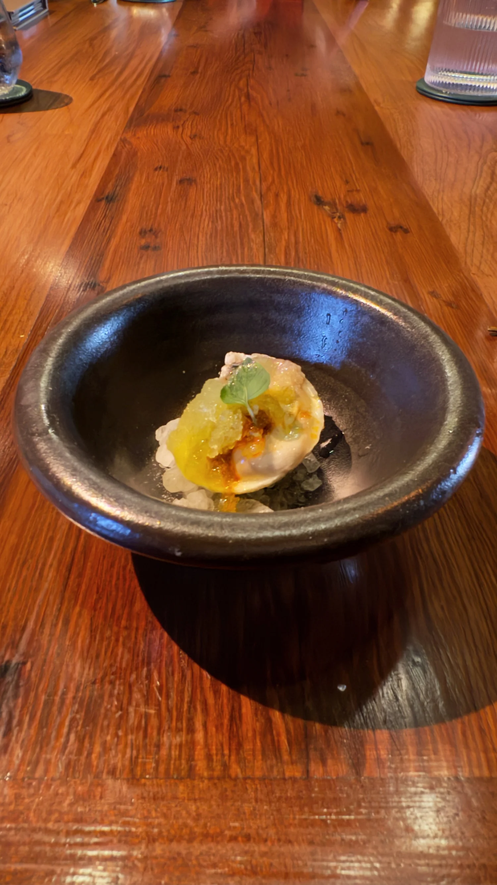
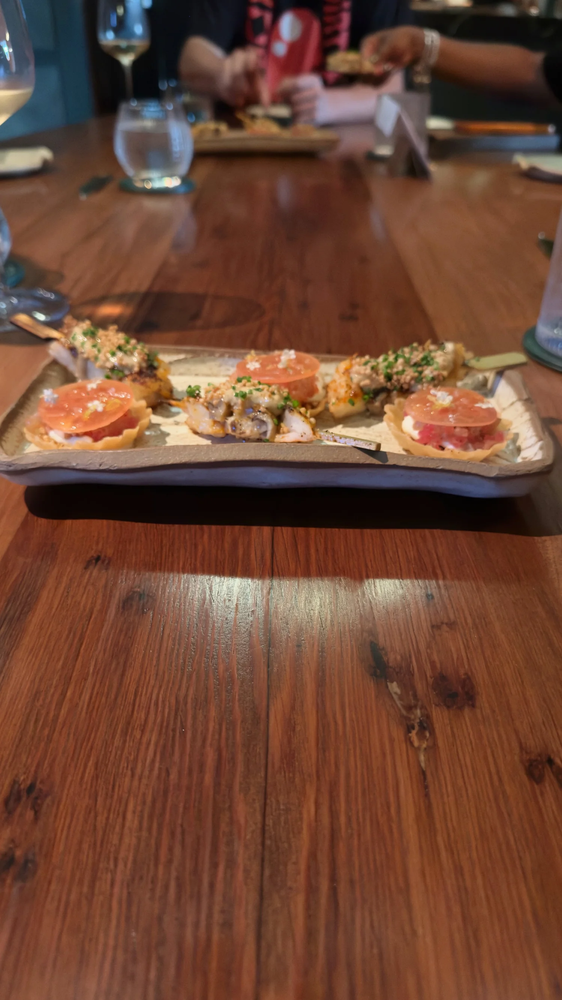
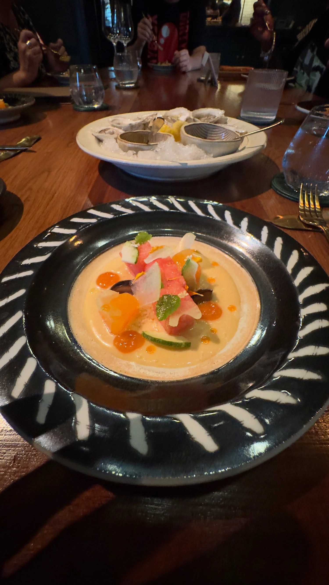
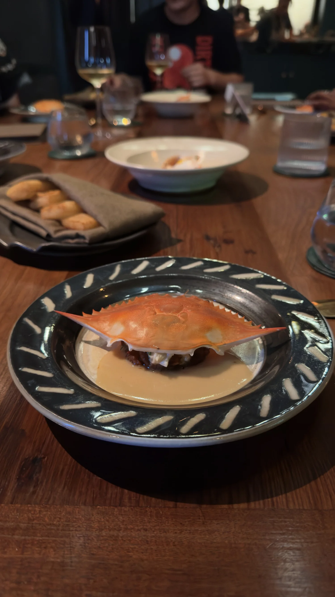
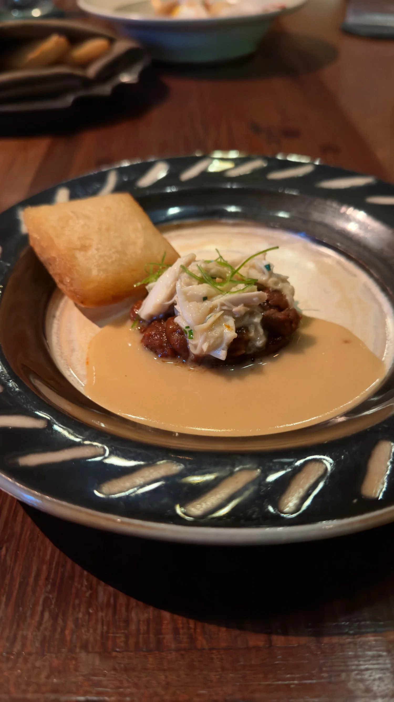
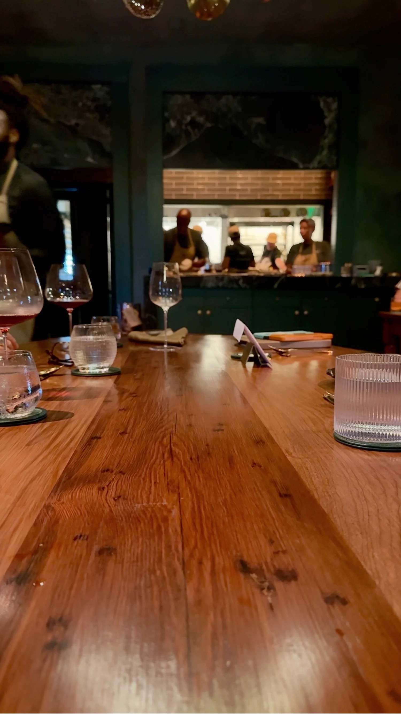
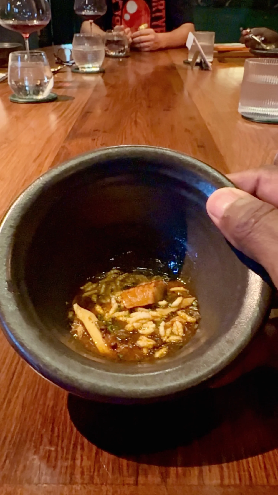
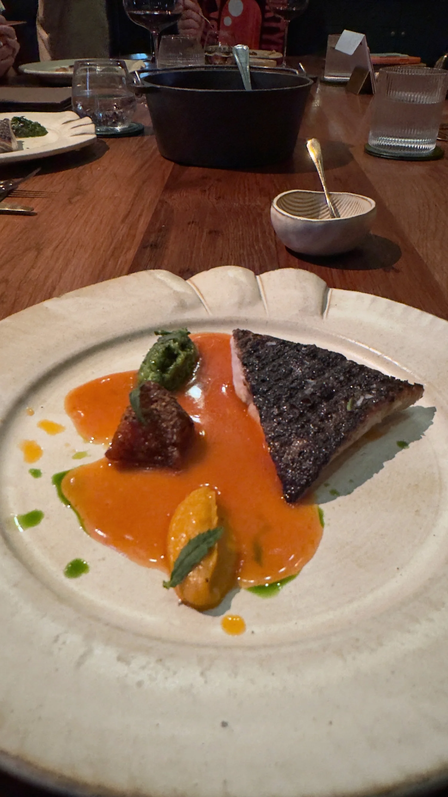
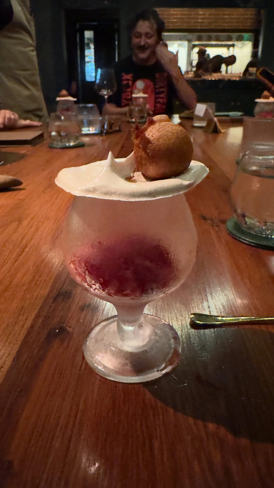
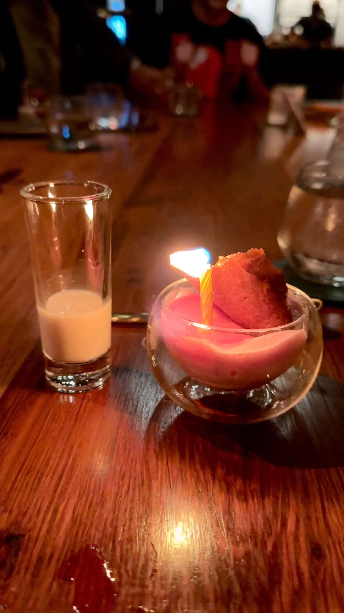
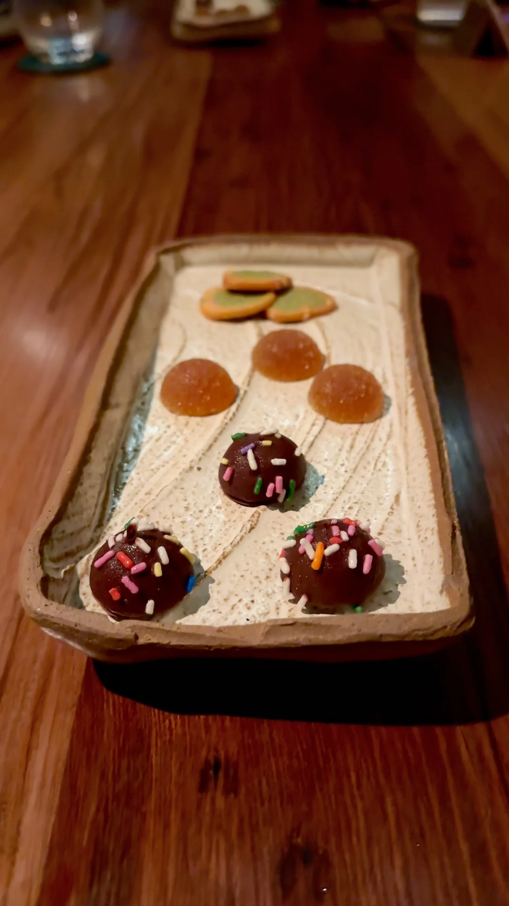
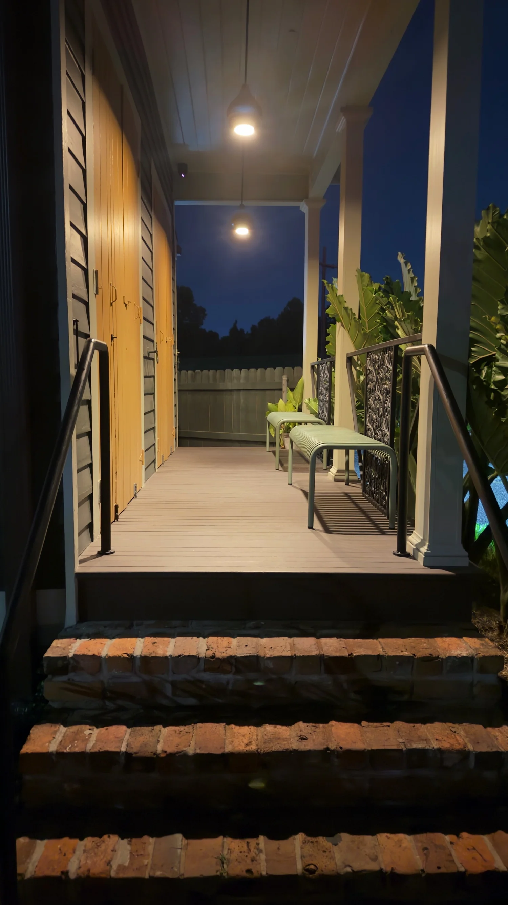

**Sound & Streets**

New Orleans is flat. Flat enough that I kept thinking about a bicycle.

I noticed dedicated bike lanes walking back from Loretta's and realized cycling this city would make perfect sense. That didn't make it into the seven-page PDF.

Another 1,000,021 edits for next time.

The city is alive in ways that don't require volume. Music coming out of open rooms. Streetcars. The Quarter. People moving toward food, music, drinks, churches, bookstores, bars. Women loving women out in the open. A city that's queer without announcing it. Sexy without trying. Spiritual without explaining.

Then there's the music. Mahogany Jazz Hall. Joe Lastie. The kind of playing that makes you sit still because there's nowhere else you need to be.

I used to run two or three miles in every city I visited. #RunThisCity. I haven't in a while.

Maybe the bicycle is next.

**The Film**

This trip I brought the Kodak Ektar H35N.

I was intentional with the first roll. Then I filled it and bought a second, and now I'm reaching for the camera more than my phone.

Something changes when you can't see what you captured. You take the picture. You keep moving. You trust it turned out.

The last roll finished with Dakar and the music at Mahogany.

**Same Mouth**

The last morning I had the jumbo lump crab Benedict. Local crab, sautéed spinach, English muffin, hollandaise, sautéed asparagus.

I ate it exactly as it came. No modifications.

That small thing got me thinking about how rare it is to sit across from someone who eats the way you eat.

The eggs aren't too runny. Nobody needs the asparagus removed. We're not negotiating with the arugula.

The same mouth. The same taste. The same style. The same curiosity. Someone who would appreciate the hotel I'm appreciating, the coffee I'm drinking, the bookstore I wandered into, the history I'm trying to understand. Someone who can break away for an afternoon and come back without accounting for every minute. Someone who knows the air doesn't always need filling.

This city deserves to be experienced with somebody. Not because you need company to enjoy it, but because some places make you want someone next to you when you turn your head and say, look at this.

**What I'm Bringing Home**

Not souvenirs. Not really.

Although there is stationery, there is a watch strap. There is a box of the chocolate the hotel left in my room on arrival, bought on purpose the second time. There are eleven inches of ink on my right thigh and a roll of photographs I haven't seen yet.

What I'm bringing home is that attention matters. That knowing what you like matters. That hospitality can be competence instead of performance. That a city will tell you its story if you're willing to listen.

And that the best parts usually happen outside the thing you planned. A song that makes you sit still. A stranger at a community table. A pour nobody asked for.

When I explain this trip to people who matter, I tell them I think New Orleans is where I was supposed to go. To honor my mother and to honor myself. I don't know whether that's grief or love coming back around.

Traveling alone taught me how to be by myself. New Orleans reminded me there's a difference between being alone and having no one to tell.

I want both. The freedom to disappear for an afternoon, and someone to come back to.

I arrived alone. The city kept making room.

MSY → CLT.

I brought some of it home.
