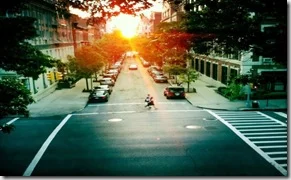

Manhattanhenge

Initially I sat down to chronicle the sights and sounds of my recent excursion to En Why Cee, however as I started to write the random thoughts, observations and inspiration; direct and indirect that developed from the experience took over …

## **The Weekend of Freedom**

### **Of Walking**

There was a mile between my hotel and the hotel of my companion(s), the walk in more ways than one helped me slow my pace. Work, kids, family, friends, appointments, cooking, eating, cleaning … existing; our lives are wired into the daily grind. Our brains need the slow pace, walking allowed me to unplug, detach from the process and provided a sort of stillness needed for introspection.

### **Of Family**

I appreciate the love and help I receive from my family on a daily basis. A strong sense of responsibility had me contemplating calling the trip off, naturally Mom & BIG sis stepped in to convince me to be irresponsible and not to worry about things. Lol, those are my words ... simply stated they convinced me that I deserved it. Find an outlet for your "irresponsible" side.

### **Of Friend(s)**

I like intelligent, cultivated folk that I can have verbal battles; I like debate and interminable discussions. What I appreciate most is that we can talk about the metaphoric pressure build up in the Earth's core {Science!} one minute and switch to a conversation about what flavor kool-aid "red" is. We all need someone with an S on their chest to come and save the day; to challenge us and to keep us motivated mentally, physically and spiritually.

### **Of Time, Space & Solitude**

The time spent in travel; planes, trains & automobiles afforded me an opportunity to enjoy a few of my favorite things … reading & music. The time created space, a space for dreaming; there is more to the world than what is before our eyes. The space created solitude; I enjoyed being alone in a crowd, my earphones in with the music pumping, grinding, going hard and sometimes soft. Use time, space & solitude to dream but don’t lose sight of reality ...

### **Of The Return to Reality**

When who you are doesn’t fit what you do it creates a see-saw effect, the classic battle of the head vs the heart. How to blend the two is a constant struggle for me, primarily because I have a tendency to resist blending them. Back to life, back to reality.

In this context *Freedom* means securing an equal opportunity for life and the pursuit of happiness. It takes discussing & planning, freedom will not materialize by itself.

Life is short, relax & let go whenever you can.

 “You deserve it.”

I Am
