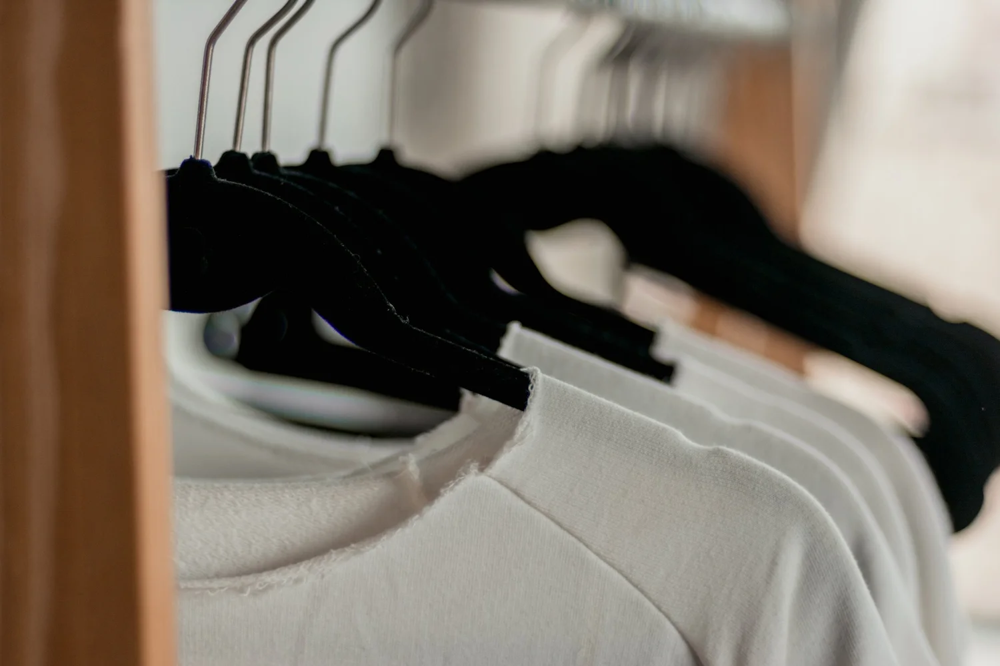

The end, or the beginning depending on your perspective, of the year is a great time for renewal. We highlight a list of goals or make resolutions. Attacking the new year with vigor, however, we don't always free up space to take on these new ideas we have for our lives.

Starting the year with a clean slate gives me the space to reflect…

### **Of the Year Behind**

What I learned, what I accomplished, and what mistakes I made.

### **Of the Year Ahead**

To plan, dream, live.

One of the things I do to free up space involves decluttering and organizing all my spaces; home, work, car, and mind. Re-owning things I may have rejected and tossing out others. Throwing out old mental scripts, reimagining exercise, and eating plans, all to make room for new ways of thinking and being.

**What worked for me and kept me whole…**

Desiring alone time to think, read, pray, sleep, or whatever.

Desiring an adequate, livable, and respectable wage for employment offered, or business services offered.

Saying NO when appropriate.

Spending quality time with and having a genuine interest in platonic friends.

Being single or not being single.

Being sad. Sometimes it allows the space to reflect and plan and is a normal human emotion.

Being happy.

*Constantly reminding myself that self-worth is not something you have to prove, or a conclusion you arrive at, it’s an assumption you start from.*

What I Am becoming acutely aware of is comfortability with replaceability;

You are only as good as you are useful.

You are only as valuable as you are needed by others.

I remain
