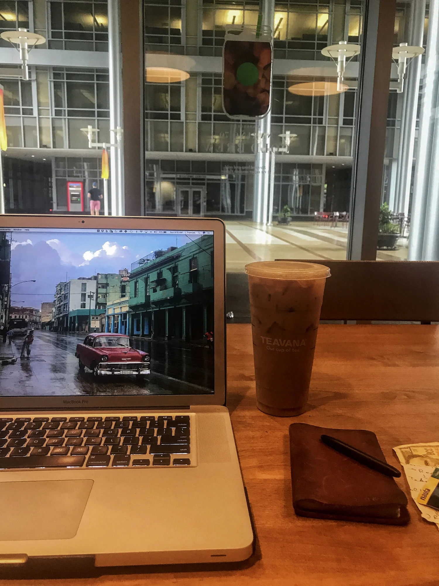
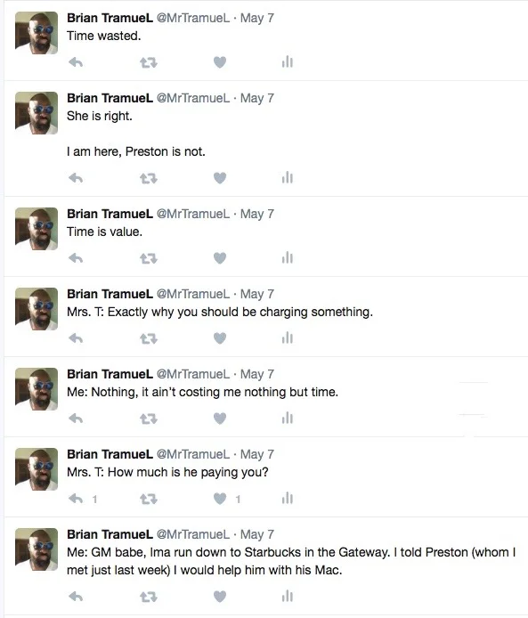
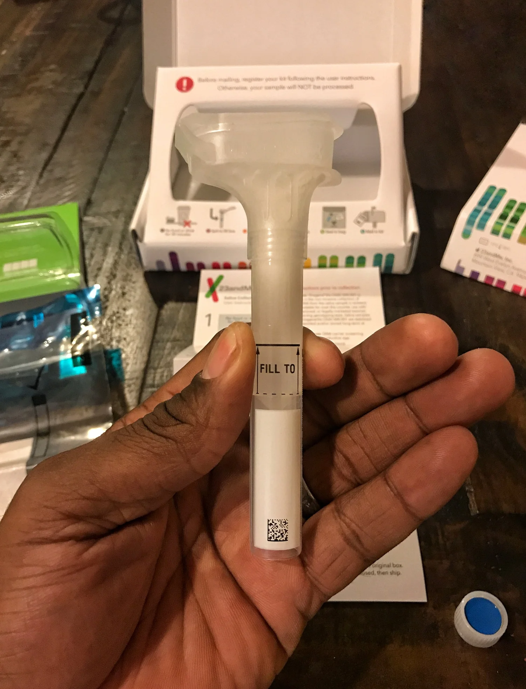

On A*ny Given Sunday*, you might find me at Starbucks, watching the Sun beam in through the windows, creating dramatic light and shadow. The strong scent of coffee, the sweet scent of cake pops and the sound of music (at times too loud ;)

Three weeks ago while writing inside of Starbucks and by writing I mean procrastinating, the wallpaper on my computer attracted attention. It was an image I captured while traveling and it led to a more introspective discussion on writing, money, traveling, history and truth.

*A point - My trip to Cuba has opened up a lot of dialogue and interest. I’m not sure if I’ve had anything have such a lasting effect on me – desiring to know more about Cuba/ns. There is so much pride and hope from a place with so much to despair.*

It also led to me agreeing to Apple training and tutorials for someone new to Apple computers. Also they wanted help with creating/organizing a note system to digitize handwritten journals and help with creating a blog.

## **On Writing**

I write in my journal and by write I mean (a) type into a number of journaling / note taking apps on my phone from Day One, Byword or Notes to (b) physically writing into Field Notes, Bull and Stash or whatever piece of paper is near me. Writing regularly along with meditation has provided great benefits for me. I'm no master of mediation, however I do steal at least 10 minutes every day to sit quietly and clear my mind. I could list many benefits but here is one; if you've ever stated "I wish I would have said ..." after the moment has passed, writing has helped me keep my opinions in draft form so I'm more alert in providing that *burn* in the moment it happens.

## **On Money**

There was a disconnect on my initial meeting of being a willing conduit into the world of Apple  and Mrs. Tramuel was quick to remind me that while Apple workshops are free, they are provided by paid employees.  C.R.E.A.M.

Time is Value.

Without hesitation I'm quick to say yes to most request for help; a ride to the airport, help with a move, re-wording resumes. At times I've apologized for not being able to help, however I'm no longer sorry for wanting to be compensated for my time.

## **On Traveling**

I recently completed an interview for [Gyroscope](https://gyrosco.pe/MrTramueL/) and one of the questions asked continues the time/value theme ...

> ***"What would your advice be to someone who says they ‘don't have enough time to travel'?"***

*Time is a valuable asset so I understand, however I would encourage them to make time. There is no user guide for travel, visiting a neighboring city provides the same experience as flying to a far off destination. Also, time is not renewable - create memories and a visual reference so you never have to say “I wish I would have done…”*

I hope they don't mind me sharing before it is posted, I'm sure y'all won't tell.

## **On History**

Speaking of Gyroscope, it was inside the app that I learned of [23andMe](https://www.23andme.com), a DNA Genetic Testing & Analysis Company. I recently submitted a sample and testing will take approximately 4 to 6 weeks.

I am genuinely interested in all of the characteristics found in the genealogical DNA test kit. Hopeful to find beneficial information about the origins, lifestyles and demographics of my ancestors.

*I’ll share my experience in [A Richer Understanding](http://retirementsavvy.net/?s=a+richer+understanding) feature on [Retirement Savvy](http://retirementsavvy.net).*

## **On Truth**

A trait I admire in others is their honesty. Unapologetically showing you the truth in who they are by owning their value judgements, assumptions and inferences. Never apologizing for their past because it made them who they are.

*“Second born has higher odds of being more altruistic p-value = 1.9 x 10⁻⁸”*

- *@23andMe*

### Science.

They swear they know me, but what strength it takes to keep me honest - I be' wrestling down my truths. To be honest, I’ll do anything I can to help someone; I’ll listen and talk for hours about their problems and problem solve if asked. I am naturally trustworthy but I lose patience quick when truths are disrespectful towards others and when they take foolish risks.

I Am
