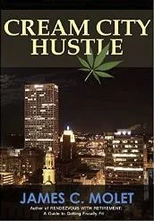

*"Marcus knew that the only way to have any chance of making it out here was to get an education and develop a plan for making, and saving, your money. Otherwise its a paycheck to**paycheck existence in low-wage jobs."*

*"Living paycheck to paycheck. Not for me."*

[Cream City Hustle](http://www.amazon.com/Cream-City-Hustle-James-Molet-ebook/dp/B00O6P2QQQ?SubscriptionId=0ENGV10E9K9QDNSJ5C82&tag=&linkCode=xm2&camp=2025&creative=165953&creativeASIN=B00O6P2QQQ)

By James C. Molet

[Buy on Amazon](http://www.amazon.com/Cream-City-Hustle-James-Molet-ebook/dp/B00O6P2QQQ?SubscriptionId=0ENGV10E9K9QDNSJ5C82&tag=&linkCode=xm2&camp=2025&creative=165953&creativeASIN=B00O6P2QQQ)

Marcus, the protagonist exhibits a combination of street smarts and natural intelligence that serves him well throughout the story as he faces a challenge with the antagonist Caine. The story kept me engaged through each climatic turn. Another point of engagement is how well Mr. Molet presents and incorporates financial terms within the story. During a point of interest Marcus explains to Train (his long-time friend) that he has established an emergency fund. While many of us understand the term, most of us do not have one established. In that respect the book introduces terms we may or may not be familiar with but also shows us how easy (and important) they are to establish and maintain.

The characters in Cream City Hustle are easily recognizable, they represent something we’ve experienced directly or indirectly; support for and from our immediate family, high education cost, feelings of despair, working low income jobs, trust in relationships and perhaps for a small few following a dark path; seeing a means to an end.

The concept of the book is familiar; as it continues the work from the author’s blog [Retirement Savvy](http://retirementsavvy.net/) where he charges us to become fiscal and physically fit.

Overall this is a strong read that resonates with me because it combines the current circle that is my life; reading, becoming physically (& fiscally) fit and investing in The Future.

Run. Lift. Crunch. Plan. Invest.

I Am
