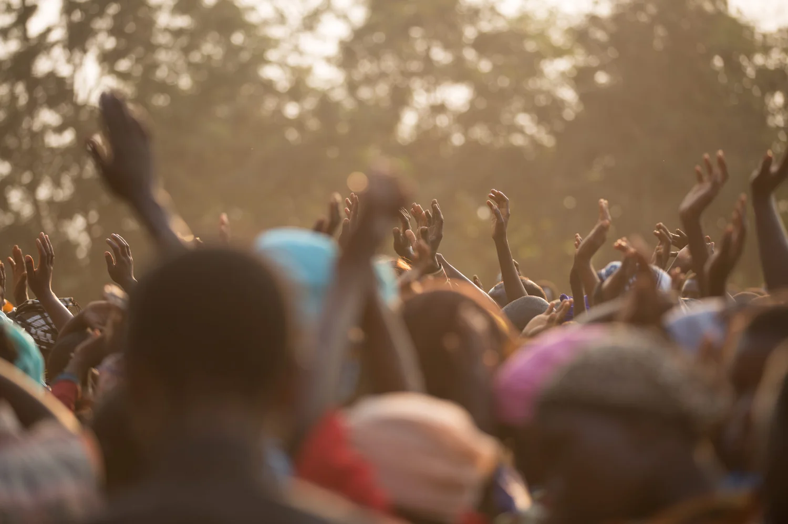

# The Dangerous E's

## Entitlement, Egocentrism, Ethnocentrism & Essentialism

I tend to take things at face value while also allowing others to live. A self-reference approach, where I regularly use "to-me" language, reminding myself and others of the self-locality of my views and to explicitly affirm the rights of others to hold their own.

*Science.*

I initially set out to write about my observations while running on the greenway and in the park(s) of the people I ‘ran up on.’ I jokingly remarked to a friend about how attitudes changed before and after the political conventions. First, after the RNC everyone seemed tense – no eye contact, no smiles, no acknowledgement when passing to the exact opposite immediately following the DNC. Perhaps I’ve exaggerated a bit but still very real, “to-me.” At last, I made it to work and the lights came on...

*Cop lights, flash lights, spot lights  
Strobe lights, street lights  
(All of the lights, all of the lights)  
Fast life, drug life  
Thug life, rock life  
Every night (All of the lights)*

*Turn up the lights in here, baby  
Extra bright, I want y'all to see this  
Turn up the lights in here, baby  
You know what I need, want you to see everything  
Want you to see all of the lights*

### **Of Entitlement**

There has been a lot of turnover in my area; charge it to lack of opportunity and what many believe are below market salaries. Development and promotion Vs. Pay me, don’t stroke me. I don’t have a problem with ambition, drive or work ethic but what I believe to be entitlement is the thought that after one year of service you deserve to be promoted or are deserving of a sizable raise. This is just one example that illustrates a consequence of people thinking themselves entitled to things they haven’t earned.

### **Of Egocentrism**

I give up conversation but don’t say ‘nothing’ during water cooler moments. I’ve learned that no one is *genuinely* interested in your weekend or little Tommy’s baseball game (save for my work wife.) Everyone loves to discuss religion, economics and politics, that is until you want to share your point of view. So I’ve learned not to discuss religion, economics or politics with anyone other than someone who has studied critical culture, gender, economics or race.

### *It’s true because I believe it.*

(See what I did there?) Egocentric thinking results from folks not valuing the point of view of others and not seeing the limitations of their own.

### **Of Ethnocentrism**

Deep sigh.

It doesn't matter what the culture is; conceptions of personal space, style of clothing, body language and eye contact communicate information and plays a role in judgmental bias. There are many who assume their view is universal and go about the business of trying to change the world or in this case the office. We are diverse with respect to cultural differences, they would do better to notice the cultural holograms that shape everyday behavior. Views on education, economic stratification, religious ties, political affiliation, racism, gender differences are not universal. The opportunity with ethnocentrism, is to always be learning something so that instead of changing the world, we can learn from it to make it a better place.

Do it for the culture.

### **Of Essentialism**

"You're not really..."

Every Friday we are treated to dinner (weekly/monthly expirations.) Normally there's not much variety as we order from classic American style restaurants. Once upon a time someone was celebrating a birthday and was asked to choose. They chose a chicken wing joint. I sit next to the person placing the order, when they saw that I ordered a burger (1st) "Surprised you're not eating chicken." & "They want to know how you want your burger cooked?" (Medium) (2nd) "I thought you were going to say well-done."

This is essentialism at its most overtly normative, coming into play when the generalization fails and the stereotype no longer works.

So you’re not really *black* if you don't eat fried chicken or a well done burger.

& to be clear, I eat chicken ... I'm eating chicken right now.

I Am
