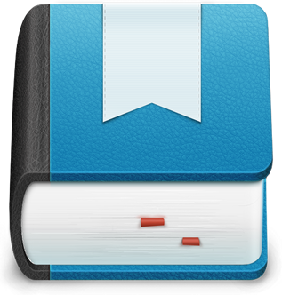
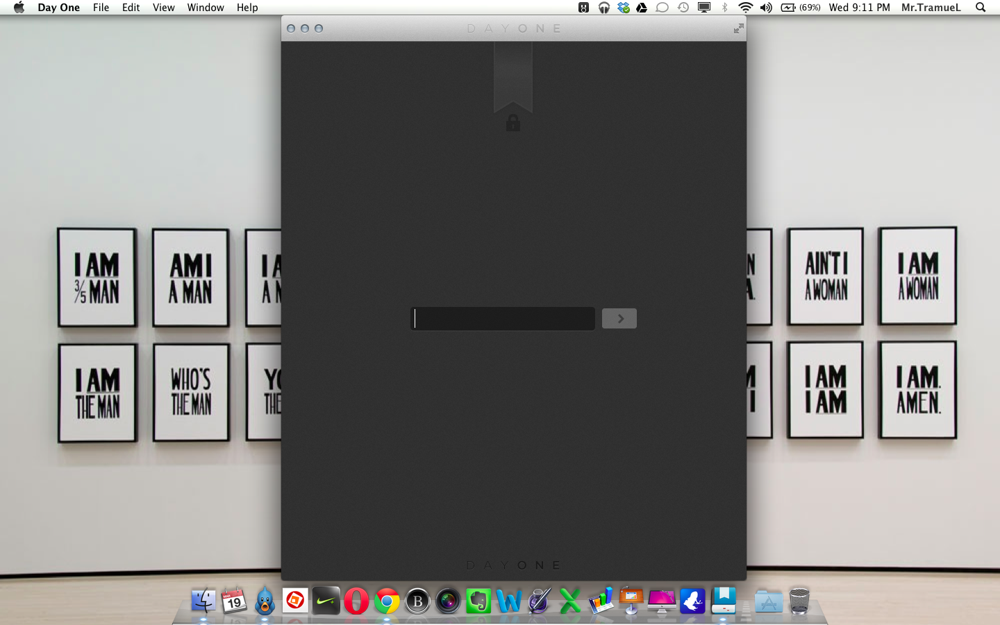

# DAY ONE

A part of my better thinking plan for the two thousand and fourteen was to write more; to steal [at least] ten minutes every day to reflect and write down ideas. Day One allows me to do exactly that with apps for iOS and OSX [OS Ten] Never, ever refer to it as "O S X" Apple enthusiast will crucify you.

& now with a genius publishing feature; the quips or opinions you've kept in draft form can be shared with the world.

don't believe me just watch...



Sorry Android, Windows & Blackberry users.

I Am
