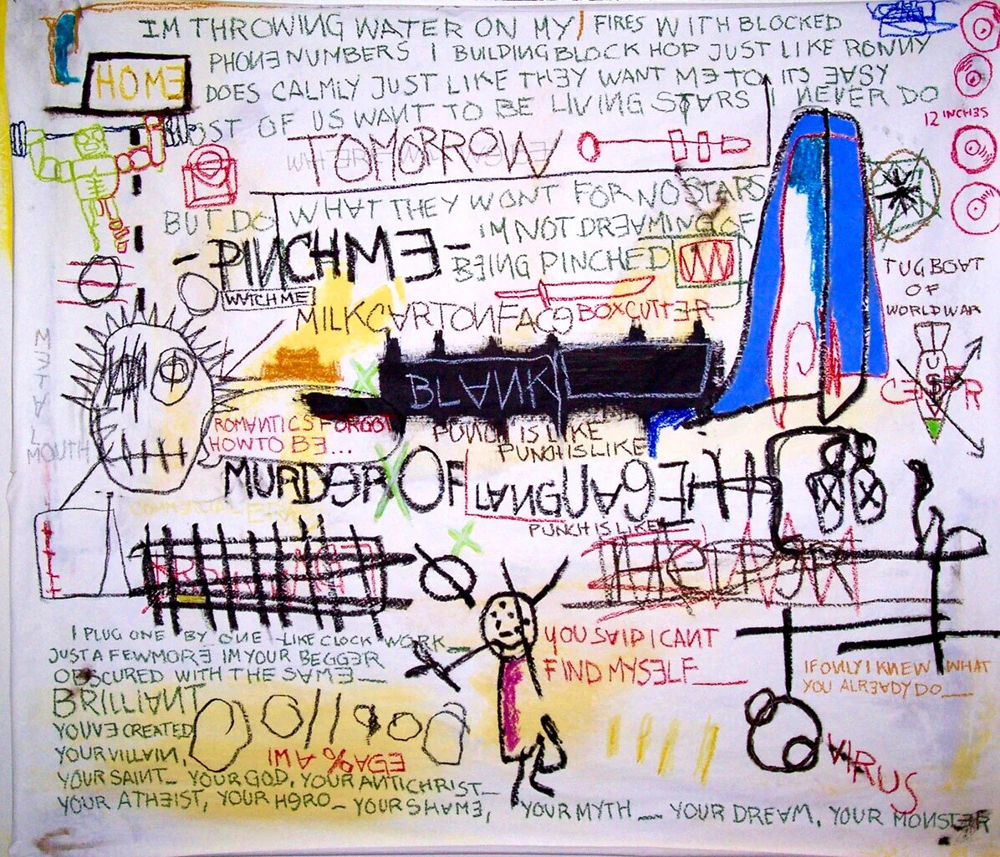

One common Virgo trait is the tendency to be introspective, additionally for me with Moon in Gemini, Moon square Mercury specifically (Science) … there is always a conflict between my head and my heart. My emotions telling me one thing and my mind telling me something else. The result is a see-saw effect: Emotional to the point of irrationality at one moment, and logical the next.

I was today years old when I realized that this continual questioning or internal debate between my thoughts and feelings plays havoc in trying to understand others. The small talk at the ice cream shop, you telling me you prefer cake over pie, deciding to pierce only one of your nipples… nothing is free from my questioning, indecisiveness, and variability of emotions. This in-house entanglement between my thoughts and feelings can manifest externally as a communication problem. I am generally able to emote openly and honestly however what another person receives can be less thoughtful and caring than intended.

Magic Always,

B
