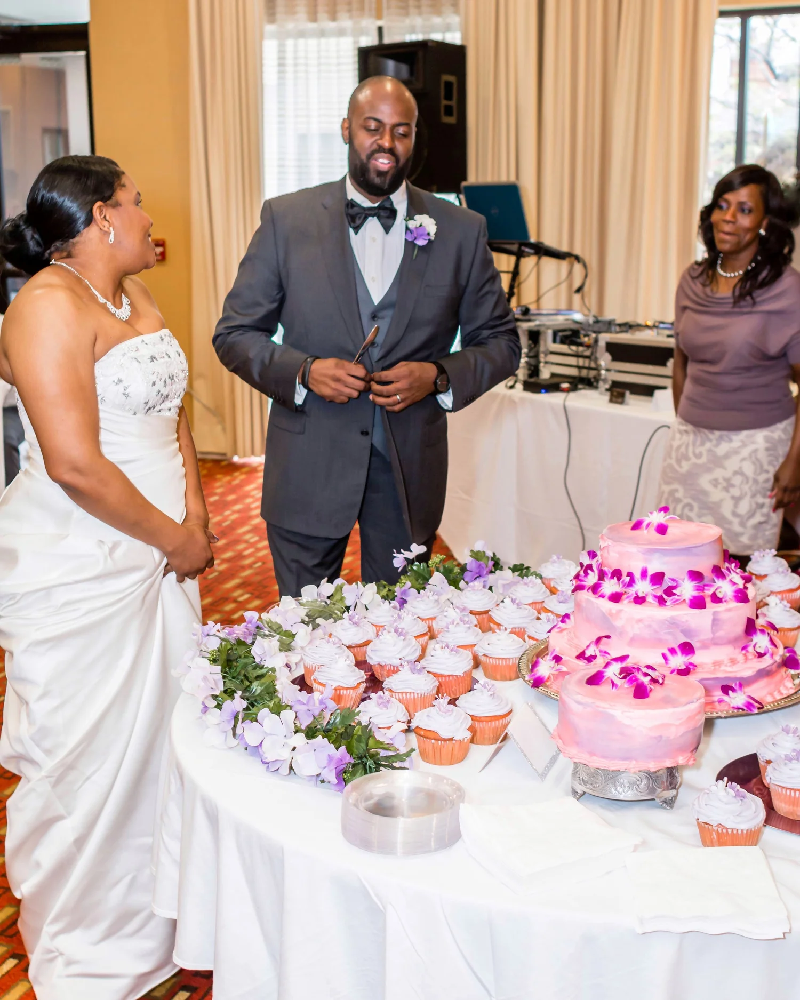

Someone asked me "why did you get married?" and I answered with quick wit and a somewhat comical reply. A typical defense when someone asks you a question you're not sure how or simply unprepared to answer.

*"Michelle keeps food in the house and the utilities on." "Also, she is fine as fuck."*

Them: "Seriously, and don't say for love."

The question was fielded by someone whom I share a lot with, there are often deep conversations where we opine about life and all of its ironic twist.

Once I settled down and realized they were serious, without much thought, I thought aloud - and by thought aloud I mean I said... "I view Michelle as a partner, someone whom I can communicate with, share every thought, feeling or desire. Where communication involves listening fully as much as talking."

Then there was a part about us sharing similar interests and being engaged in them together but also allowing each other space, without jealousy or envy, but the trust to do the things we enjoy individually.

Then there was the part about money. In all of the time I've known Michelle, we've never had (serious) issues with money. Probably because men are rational, sane thinking and a loving husband seeks his wife's best interests regardless of her response. (If Y'all know her don't tell her I said that part.)

I know her love language and try to speak it regularly. Don't get me wrong we are not perfect and there are times that I think jumping off a cliff would be more bearable than to sit there arguing with her about nothing. We certainly do not have a blueprint, we are absolutely unique just like everyone else.

Things changed for me (essentially us) when I put Michelle at the top of my priority list and asked her three questions, one of which she gave me a solid answer. "How could I be a better husband to you?" Her teaching me led to things being reciprocated and this is the reason when others at work are complaining about their wives, girlfriends and significant others I just smile, relaxed in love.

I Am
