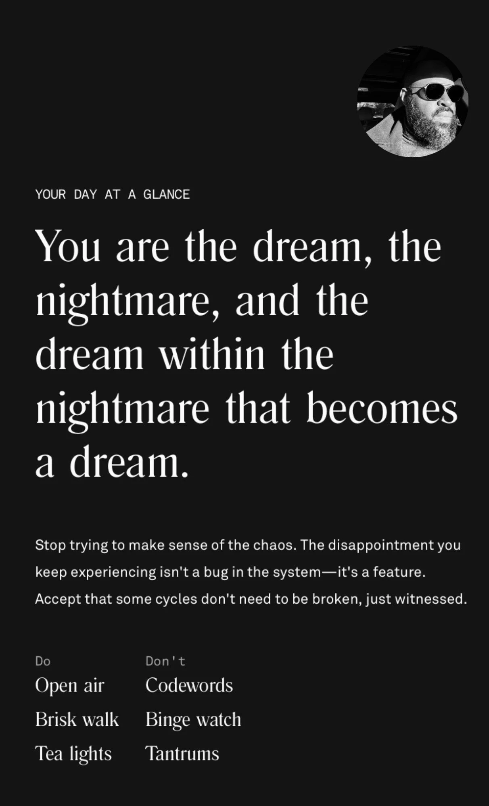

The recursion is doing real work. It doesn't resolve anywhere. You just keep falling through floors.

*"The disappointment you keep experiencing isn't a bug, it's a feature"* is so sharp that I cut myself. I've thought it but never said it out loud. The do/don't list at the bottom is perfect too.

Open Air vs. Codewords

Brisk Walk vs. Binge Watch

Tea Lights vs. Tantrums

Whoever made this knows exactly what kind of day this is.

My chart makes the quote make complete sense. Virgo (Sun) wants to organize the chaos, Gemini (Moon) is generating half of it, and Libra (Rising) is out front trying to look unbothered while all of that is happening internally. And then Scorpio placements underneath all of it, just... watching. Witnessing. Never letting anything go.

*"Some cycles don't need to be broken, just witnessed"* is basically Scorpio's whole thesis.

Co-Star leans dark and it works because it doesn't try to be encouraging. It just tells you what it sees. Very different energy from the apps that want to hype you up every morning.

I Am

