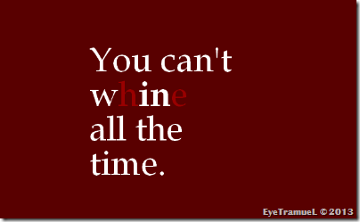

Untitled-1

Sunday night I watched my social media streams fill with commentary about all things entertainment; Game of Thrones to Beyoncé to the NBA. As fans, stans, and critics; we discuss things for ‘investigation’ and gossip, both understanding and insulting. No matter your point of view, there is always that friend or follower who believes they have a personal connection with a celebrity and will stan until the end of time.

It is relative I suppose. I stepped back and looked at the converse after choosing not to watch Beyoncé headline a benefit concert or the second half of game 7 of the Eastern Conference Finals. Why do I not care for Beyoncé? Why do I dislike the Miami Heat? I’ve never purchased a Beyoncé album, I do however enjoy some of her music. There is a faux humbleness that I receive from her and It is hard to imagine someone having the wherewithal to obtain the level of success she has garnered to come from such a sweet, innocent, back straight sitting in a chair, look at me I’m Sandra D, puppy sister. I appreciate what she has accomplished with her music and in her life. The same is true for LeBron, I respect everything he does on the court and also the things he does off the court. I admire Dwayne Wade for the same. I can let Beyoncé live but I do wish for the Heat’s star to fall.

*I don’t believe they deserve success.*

While there is no way to determine if someone deserves success or not, in sports there is a measure based on how someone plays. I’ll admit that my dislike for the Heat has nothing to do with individual play but more about [*the decision*](http://www.youtube.com/watch?v=bHSLw8DLm20) to create a dynamic usually obtained by scouting, the draft and free agency. Chicago, Indiana, Memphis and Oklahoma are a few examples of teams who’ve found success this way.

Mute your dissent.

Their success or failure really has no bearing on my life. Even if I feel they don’t deserve success, there is no real reason to adamantly rejoice in their failure.

However, go Spurs.

I Am
