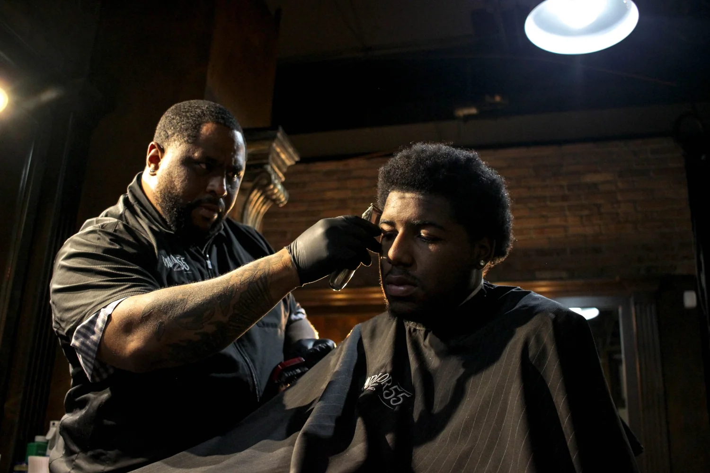

Over the Christmas and New Year Holidays, my barber traveled to Jamaica to spend the last few weeks of 2017 doing some maintenance and upkeep of a home he owns. In conversation, I eluded to the fact that I would be here in these United of States looking unkempt while he would lay on a beach looking at beautiful women kissed by the Sun. He assured me that it was not a trip for leisure.

The fact that he entertained my selfish concern for my appearance and not a genuine concern for his safe travel and a well wish for the holidays shows the trust men develop with their barbers and vice versa. I’ve known “Jay” for twelve years. I have visited his home, met his wife, daughter, and son. He was one of three non-family members invited to Michelle & I’s wedding.

While there have been opportunities when he has closed for vacation or holidays, none have lasted more than a week so I was able to maintain my appearance. Seriously, once that trust is established – if he posts his vacation schedule, I simply come back the following week.

I violated an unwritten rule, doing so I learned two things (1) Never trust a big butt and a smile and (2) Patience. The rule? Do not consider a new barber when your barber is out of the country.

I work in Uptown Charlotte and while out walking the city streets during lunch I was handed a flyer for a Men’s Grooming Lounge by someone with a big butt and a smile. The flyer had “The Barber’s Cut - $39” and honestly that should have been the flashing red sign before the cliff but my mama always said I had Hugo Boss taste on a K-Mart budget. So, I went online to check them out, I’ve passed the place several times and thought I would shut down the ‘gram with a few pictures inside. The barber’s cut includes a shoe shine and hot towel.  What should have been added was what was NOT included – A beard shape up, that was an additional $20. Add the one, carry the two … the Science doesn’t work for me.  Adding up what I pay now for full service (cut and beard shape up) and it equals almost three times what I would pay, including a tip.

I go home and tell Michelle about it, excluding the part about the big butt and a smile of course. Who at the very least wanted me to shut up complaining about what I was going to do with Jay leaving for two weeks. I know this because while I was complaining she was online purchasing a gift certificate, an early Christmas present she called it.

***My wife is better than yours, probably.***

For a few days that followed I would go to the site, make an appointment but never finalize it because I know from experience that most barbers do what they want, not what you want them to do – when they don’t know you. This game works for Aaron & Brian because of their youth. My hairline is receding and I have a very thin spot on top. I need a barber skilled in the nuances of magic. Jay cuts my hair down low enough to match the thinning spot up top, he also doesn’t cut too far into my natural beard line because he understands part of the reason I grew a beard is that I hated shaving. I played with services like a beard facial – I would just get them to do that and line it up and I’d wait for Jay to return for a cut. Back and forth, back and forth until there were no appointments available for that day.

This went on for a few days until finally, they were closed for Christmas and two days after. At this point, I really should have waited but I moved under the assumption that Michelle and I would be going out for NYE and wanted to represent her right. “Michelle’s husband is so fine.” That is what I’d hear them say.

I go ahead and set it up; The Barber’s Cut and a Beard Shape Up. The appointment was on Thursday, December 28. I was greeted, they took my coat, gloves, hat, and scarf because it was cold as fuck that day. They offered me something to drink and pointed me to the waiting area.

The barber was born and raised in Charlotte and appeared to be around the same age as me. I explained that Michelle was also born and raised here and graduated with former Mayor Anthony Foxx, we have to hear this any and every time someone mentions "Anthony" ... that bit of detail confirms that he is our age as he stated he came out around the same time.

I provided very detailed instructions on what I wanted, I thought I was clear but once he started with the line up I knew I was in trouble.

The service I was provided was like nothing I had experienced, they took my boots off of my feet to shine them - other men were receiving hand massages and foot massages as part of their service. After my shave, he placed a hot towel over my face and I believed I was in Heaven. After my cut was finished he took me over to a sink to wash and condition my scalp and I thought I had returned.

I was floating when I left there, it was an excellent cut and shape up but would require a lot of maintenance and a weekly trip to the barber and for $59 a pop, ain't no one living like that.

It is going to take another month for my beard to grow back the way I like it, the line did not follow the natural pattern my beard grows, in fact, he cut into one side so far I almost decided to cut it all off and start over. I cut my hair low already but had to go another step lower to correct how far back he had gone into my already barely existent hairline as it is. I'm level five Lebron.

Lesson learned, next time I will be more patient and wait for my barber. I'd rather look unkempt than cut the fuck up.

Magic Always,

Brian "Patience" TramueL

