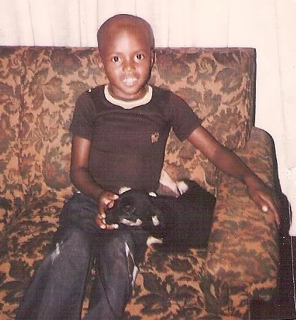

# Life and Music

## Soundtrack of My Youth

> *I’ve expressed my love for music & ya’ll know I’m a bit kooky. I often relate things happening in my life to the music I am listening to. While it is not specific to the songs lyrics or meaning; a phrase, a verse or the hook may spark a thought.*

> *Life set to a few memorable songs from my youth...*

## **[Cutie Pie](https://dl.dropboxusercontent.com/u/2869333/Cutie%20Pie.mp3), One Way 1981**

The infectious baseline, backyard cookouts at Aunt Hazel's, Uncle Tuck spinning the records. A period of innocence, spontaneity and impulse. My first "will you go with me; check one, yes or no."

## **[Planet Rock](https://db.tt/tdpoMi7Q), Afrika Bambaataa & the Soulsonic Force 1982**

Life is slower. Mom & Dad's basement house parties, the neighbors calling the police instead of calling the house. They asked us to turn down [for what?]  This song represented freedom, and independence.

Side Note: I Am always reminded of a scouting trip cut short by what I will call "Poo-Gate" My mother had recently enrolled me in a neighborhood Church's scouting program, a few weeks later we were on a camping trip. I knew most of the kids. The trip had been full of pranks but none greater than someone placing poo in the cooler of another camper in the middle of the night. Didn't see the big deal at the time, I was young I suppose. Now, how disgusting was that. They threw me out of the program as no one claimed responsibility. Just as well, I never wanted to be there. I believe my mother was trying to keep me active. We still don't know who did it.

## **[The Glamorous Life](https://db.tt/UYlGlzLp), Sheila E. 1984**

Having my sister go before me, provided many opportunities that allowed me to just be. I remember tagging along to this one party, I never heard her ask "Why does he have to go?" I played the back, my introversion never allowed me to stand out. However, being there, watching how others interact I began to follow my more social instincts and open up.

## **[Summertime](https://db.tt/aD2AWzuQ), DJ Jazzy Jeff & The Fresh Prince 1991**

Basketball in the park, pool parties, lighter diets and freer clothing. Less concerned with the state of the world and more about how it could or should be. I was raised by Roanoke but it was time to leave.

Forever Young, accept growing up as inevitable.

I Am
