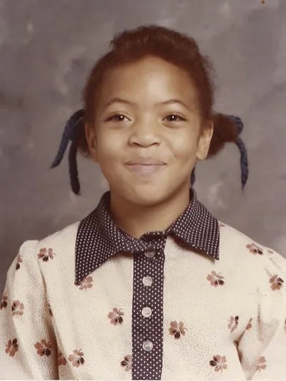

## Youth, Don't You Rush To Get Old

I often look back over my life, my youth and think about what I "coulda, woulda, shoulda."  Not that the opportunities weren't afforded to me, I just didn't take hold of them… I let go.

As the saying goes,

> "If I knew then what I know now"

And if I ***could*** turn back time, I ***would*** tell my younger self, don't just live in the moment, look beyond the right now.  I ***should*** have taken time to plan wonderful things for the future.

I think about my two teenage daughters and pray that they make wise decisions, but also revel in the wonderment of being young and carefree!  I'm guilty of  telling them to "grow up!"  when I deem it appropriate.  What I've come to understand is, that period between childhood and maturity… it's exactly where they should be.

Close observation of my daughters has taught me how to be youthful again. They know how to be happy, young and fun!

And with that being said, I'll close with my youngest daughters catchphrase:

> "To infinity and beyond"

The Wilkes; Tee, Bridgette, Zoia, Mya & (Cooper - four legged family member).

Added to my parents John & Nona, my Aunt & Uncle Richard & Hazel, they are my real life examples of love, marriage, connection, commitment and dedication.

B. Wilkes, my sister I'm proud of who she was/is/will be.
