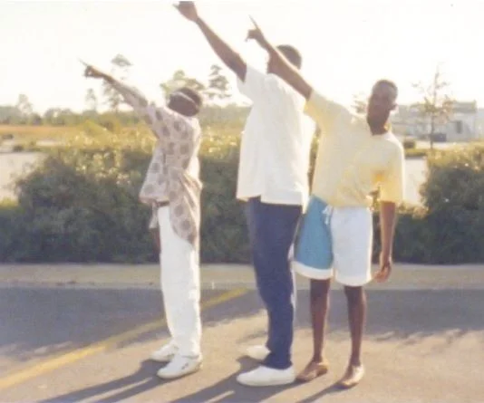

# Ahhh Youth…

I sat down thinking that this would be a quick and easy topic to drop a few lines for. As I sat brainstorming on how to tackle this theme I thought back to my adolescence. Youth for me was filled with a distinct feeling of not knowing who I was and where exactly I fit in. I was constantly trying to find that comfortable persona that would allow me to freely fit in to the social scene that I wanted to be a part of. Looking back, I remember being impressed by my friends and classmates that seemed to have found their lane. I wished at the time that I could have the confidence in myself that they seemed to have.

Youth is defined as the period between childhood and maturity. I would define it as the time when self-realization is actualized. During our childhood we are basically a reflection of what our parents and guardians teach us to be. As we progress through to adolescence we start to realize our own personalities and traits. We are after all a product of our experiences, and they shape us during these formative years. Some of us are blessed enough to be able to find our self-assurance early and define our path, while others of us search for it into adulthood. We put ourselves into situations that gave us a chance to accumulate the life experiences that helped to develop us into the people that we are today. They permitted us to acquire and develop the many skills and talents that, in their entirety, allowed us to find our self-confidence. This in turn guided us into the path that we followed.

Peering back into those days of uncertainty, I now realize how important that period was for me and how much I actually treasure those days. The laughs, the tears, and everything in between. The losses the gains and more importantly the experiences themselves. I surmise that I am still growing into that person that I am destined to be and because of that I will be youthful until the end.

There is only one direction that I can continue to travel…

Chris is a longtime friend from the Star CIty of the South; a husband, father and dynamic thinker.

Also from Chris on the blog [Forty One Years To Life](http://tramuel.com/iam/2011/09/17/c-black) "Aging"
