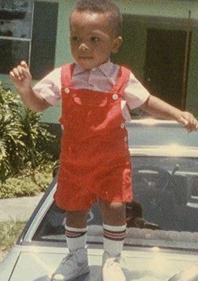

# FIve Grown Up LessonsThat Developed From My Childhood Memories of Batman

Growing up, one of my most enduring memories is of watching Batman in all of his incarnations from the goofy 1960’s version all the way to the darker version in the 1990’s. As a child, I looked up to this character because he seemed more real than other superheroes. He didn’t come from outer space, or have super speed. He was just a regular guy who wanted to do something heroic.

To a skinny kid growing up in the 80’s and 90’s, that was beyond belief!

Years later, I’m still interested in Batman. It’s kind of weird considering that Batman/Bruce Wayne, on the surface, has nothing in common with me. I grew up a poor, skinny Black kid in Florida with a single mother, brother, and sister. The hero I looked up to was an (imaginary) rich White socialite who had enough money and resources to launch an all-out attack on crime that even the police couldn’t handle.

Yet, somehow I related to Batman.

Over the years, I’ve had a chance to reflect over my interest in Batman and how it shaped my life.

Here’s what I came up with:

## It’s OK not to have a “complete” family.

One thing that stuck out to me was Batman’s background. Batman grew up as an orphan after having his parents violently taken away right in front of him. Bruce Wayne didn’t have the “happy family” background of Superman.

Neither did I.

From the time of 5 years old, I had very little contact with my father. My last memories of my father are an army plane set that he gave me. It was an exact replica of the army base where my father worked.

Growing up, I struggled with doubt about why my father left. Was I not good enough? What did I do wrong? Why wasn’t my family like the others?

Watching Batman was an eye-opener for me. Bruce Wayne didn’t have a mother or a father. He was raised and mentored by Alfred. Watching that orphan turn into a superhero meant that I had a shot at being a hero with the people I had around me.

## The world is not always a safe place, but it can be a better place.

Another thing I learned pretty quickly from watching Batman is that the world is not always a safe place. Yes, Batman saved the day in most cases, but he always had to save some another person in the episode.

As a child, I had my share of bullies and name calling. I was a quiet, skinny kid who liked to read, so it was obvious to some that I was a nerd. For quite a while, I accepted that belief about myself. Instead of challenging or confronting the bullies, I hid.

As I got older, I remember the first time I stood up to a bully. It was in the fifth grade. Thinking about it now, I laugh. In the fifth grade, my usual bully had decided today was my day to bullied. He started to hit me. Normally, I did nothing (and hoped he would stop) or tried to run away. This time, I defended myself. I used my backpack as a shield. It took the bully a few minutes to stop, but he did when he realized that this crazy kid would not stop using his backpack as a shield.

## Things happen. It’s more important what we do with them.

In “Batman Begins”, Bruce Wayne experiences failure after going through a period of superhero awesomeness. Alfred, his mentor, responds to Bruce Wayne with this quote: “Why do we fall? So we can learn to pick ourselves up.”

Thinking about it, we all face situations (both good and bad) that happen to us.

I lost contact with my father.  
I was born to a single mother.  
I was born in poverty.

I was put in Honors classes based on a teacher’s note.  
I grew up in a family where a sense of humor is highly prized.  
I won a trip to a $900 a night hotel because I was only one of two people who entered an essay contest.

Over the years, I’ve started to appreciate the impact of the phrase “Things happen”. It’s such a simple phrase that can take an entire lifetime to learn.

Batman was a unique superhero in that he could fail. You know Superman was going to win the day, but Batman’s success wasn’t always so clear cut. There were times when the criminal got away. when Bruce Wayne got tired, and Robin (his trusted sidekick) said “No”.

## We all wear masks.

Watching Bruce Wayne turn into Batman (and Clark Kent turn into Superman), taught me how easy it is to be someone else. While I found it rather foolish that people couldn’t tell the difference between Clark Kent and Superman, I totally believed Batman’s transformation. The idea, thought, that we could become someone else so easily was empowering as a child.

As a child, no matter what happened outside, I could pretend I was Batman on the inside. I could be heroic. That was empowering to me whenever I felt that I didn’t measure up. One of those particular times was when I ran on the wrong side of the field during 3rd grade. Up until then, no one had taught me about football, so I had no clue. Looking back on this, I laugh. At the time, it wasn’t so funny.

What did I do when I came home? I watched Batman. Problem solved

## Life is complicated.

Lastly, the biggest grown-up lesson that I learned from Batman is that life is complicated. In Batman, you don’t get a morally clear answer on everything. Catwoman is a thief, but she also helps Batman at times. Bruce Wayne has to lie to protect his identity, while he has to expose criminals.

Watching this play out on television, comics, and books helped me understand (from an early age) that life is complicated.  Knowing that helped me deal with (some) of the issues of adolescence and young adulthood. I was OK with the fact that I was growing up, yet at times wanted to leave the adult world behind. I was OK with the fact that I had to be an older brother with more responsibility while also wanting to just to be an ordinary teenager.

I have come to realization now that if someone were were to ask me what I wanted to be when I grow up, I would still say “Batman”. That, coincidentally, was the same response I would have provided as a child.

Why?

The answer is simple. My memories of Batman served as a mentor and an example of manhood when there were few good memories around me.

I met Charles through social media via his unique blog post and informative tweets. As evidence by the post he has a wonderful story to tell and a good dose of information to share, you can find him here…

[Book Blog](http://thiscollegedropout.wordpress.com)  
[Life Transformation Blog](http://yetanothercollegedropout.wordpress.com)  
[Google+](https://plus.google.com/u/0/108053889768150036085/)  
[LinkedIn](http://www.linkedin.com/in/ctfranklin)  
[Twitter](http://www.twitter.com/thecharlesiwas)  
[Facebook](http://www.facebook.com/thecharlesIaM)  
[Pinterest](http://pinterest.com/ctfranklin28)  
[Instagram](http://instagram.com/ctfranklin28)
