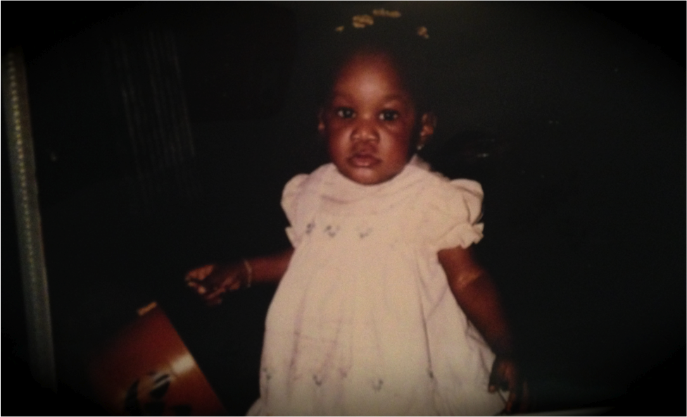

# It's a Hard Knock Life

## **Then**

Chicago

The Windy City

Chi-town

Land of Lincoln

## **Now**

Chi-raq.

## **Then**

Cheetos Flamin’ Hots with nacho cheese

$.25 candy

Playing outside with friends

Gangs protecting their turf

Children growing up  
  
Project kids living the project life

## **Now**

Children killing children

Drill music (Chief Keef, Lil’ Mouse)

Neighborhood kids forming gangs no one even heard of before

Project kids taking over the suburban life

$1.25 candy (plus tax)

## **My city is no longer the city I remember.**

Now, you have to watch for flying bullets meant for someone else.

Now children have to be mindful of what neighborhood they are walking into.

Now parents have to bury their children more-often than the other way around.

Now instead of Navy Pier, Lake Shore Drive, The Magnificent Mile, Deep Dish Pizza, Italian Beefs, and Mild Sauce the city is known for gun violence.

Now, the city remembers Antonio Smith, Lil JoJo,  Kenos Glass, Hadiya Pendleton, and Jonylah Watkins

RIP

C. Garner, my willing conduit into the [real] world of Chicago.

She writes thoughts at random on [Wishful Thinking](http://wishfulthinking1285.wordpress.com).
