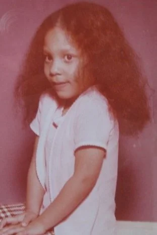

I was just a girl talking to a boy I knew of from school. We were headed in different directions but found ourselves meeting in a common place.

Grand Central Station.

I sat on the creaky wooden benches while my Dad purchased snacks for us to have on the train back to Stamford. It wasn’t really the safest thing, thinking back to NYC in the early eighties. But he was trying to save us both the embarrassment of the..questionable reading material…so openly displayed back then. But he could see me and I could see him.

So there I was when I noticed ***him***. He sat behind me in class. He had a group of friends who did not spend time noticing me. But there he was. Staring at me. I smiled at him and he looked around before coming over. He sat on the bench in front of me and leaned over. Small talk about our teacher and his hippie clothes. Small talk about the absurdities of home work. My Dad came over just then and ***he*** started to almost run.

> “Oh you don’t have to leave, young man. You know my daughter already?”

> “Yes, Sir” He said. “From school”.

I gave my dad a giddy grin.

Seeing things were okay, Dad took that moment to use the rest room.

***He*** told me things I felt were secrets. This cool kid telling me cool things that sounded just like the things I could have been saying but were somehow not as cool.  
  
In that moment. We may have become friends but his mother came from where ever she was and snatched him up by his collar.

> “You find the worst people to talk to.”

She yelled at him, and looked back at me like she wanted to spit.

There’s a big difference between “innocence” and “youth”. We were young, but not innocent. We were not ignorant of the things we may or may not have been sheltered from. But in that moment, our *youth* allowed us to feign innocence and have a moment we both needed.  The more we age the less we can pretend to not know. To be unaware of really, anything. ***He*** knew what his mother’s problem was before I did. But I knew too. I was glad my father wasn’t there to see what happened. To see the hurt on his face to know that his beloved daughter was not shielded from racism.

I would like to say that ***he***and I became friends. That we ate lunch together. That we had more talks. I would even like to say that I never saw him again. That he moved away.  But the reality is, the most we shared after that day were sly, short glances. Not even a smile. We both knew something that we could not pretend we didn’t know. We had aged just a little more that day.

And we couldn’t give it back.

A few years back I killed Cynthia in Mafia Wars on Facebook, we've been tight ever since. She is a new wife & first time mom. That nurturing instinct is a powerful source of help in the lives of others.

Also from Cynthia on the blog [Forty One Years To Life](http://tramuel.com/iam/2011/09/04/forty-one-years-to-life-cynt) "Aging"
