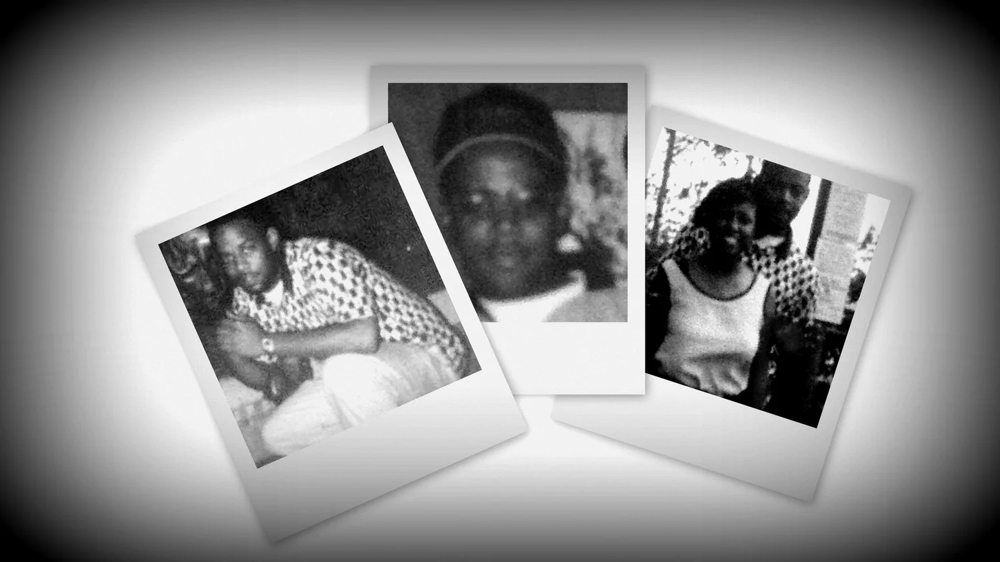

# Remember The Time: Teenage Love

Tracy, pictured below, is one of the most hardworking, educated, career-orientated, smart and intelligent people I've known in life. She was also my teenage love. Raised in the same neighborhood, we attended high school and one year of college together (I left as a sophomore and enlisted in the military). Together we share a child, my oldest daughter Christina. If anything like her mom she's headed for a good quality of life. The same can be said if she follows in my footsteps, but only after learning the hard way. Some teenagers prefer the hard way, anyhow.

Teenage love is a peculiar thing. For many, it is one's true love. Those intense and exciting, always-on-my-mind kind of feelings that will last forever and ever, if you let a young person tell it. While there are significant relationships afterward, teenage love is hardly forgotten. It represents coming-of-age for youth. The transition from childhood to adulthood. Most of the things I'd done in life for the very first time such as college, traveling, parenthood and moving out of my mom's house were done with Tracy.

To the day, my mom wonders why we never married. This, after apparently forgetting her years of advising Tracy to go on with her life cause I had no intentions of doing the right thing. Some are fortunate enough to spend their entire lives with that one person with whom they initially fell in love. More than a few of my family and friends can attest. Others, like Tracy and I, still manage smiles and laughter every now and then, while reminiscing upon a point in time where we didn't know the first thing about love.

But I'll be damn if it didn't feel like we did.

D. Christopher,

Former blogger, freelance writer, currently studying Criminal Justice, member of Alpha Phi Sigma: Criminal Justice Honor Society.
