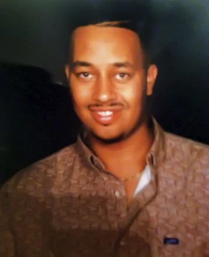

# The Rupture

The cocoon had been somewhat comfortable, but it was confining. Worst of all, I could see outside of it.

I had only consumed the mental and spiritual nectar, that my parents wanted me to eat. I hungered for a broader menu intellectually, and for a more diverse range of acceptable companions, besides the ones who were stuck in cocoons like myself.

I wanted to fly. I envied those who fluttered past me, navigating the breeze, tasting and tiptoeing from flower to flower. If I got smashed on a windshield, so be it. At least I had my freedom to crash and burn.

I was bound by the cocoon. Whenever I tried to flex my sprouting wings, the cocoon painfully constricted me. The tighter it bound me, the harder I flexed.

I spent a lot of time observing everyone around me, and my surroundings. I learned to camouflage my true colors, to outwit being beaten or eaten.

As I neared maturity. My cocoon became more transparent. My parents could see what was developing inside. Their mouths fell agape. They were mystified.

I was not a butterfly at all. I was an older soul.

A throwback. A creature of the night.

Prone to chase bug-zappers, neon and incandescent lights.

“A moth! A moth! A big black one at that!”

A friend of the drunkards, bloodsuckers, and gnats.

“Dear Lord, what happened? We tried our best.

We wrapped him in scripture,

but he must be possessed!

He never keeps still,

He keeps trying to break out,

We cannot abide that this one,

Lives in our house!”

Cut from the branch,

My cocoon and I plunged,

The ground rushed up to meet me,

I struggled and lunged,

I hit the ground kicking,

My wings were still wet,

My cocoon had exploded,

I wasn't free mentally yet,

I peered up at their branch,

As I stumbled on the ground,

They wouldn't speak to me,

I was out of bound,

I crawled and I flapped,

My wings beat with a rush,

Into the night sky,

I had just needed a push.

A Fuller Perspective, "Today is a gift...thats why its called the present...and I'm tearing into it."

Edward is a high-school friend, son of the Star City of The South and talented artist. I don't see him promoting his art much so I will. Visit has collection at [Pixels Dot Com.](http://pixels.com/profiles/edward-fuller.html)..

> [Edward has used paint, brushes, pastels, pencils, pens, cameras, fists, and whatever it took to express his concepts since his childhood.](http://pixels.com/profiles/edward-fuller.html)
