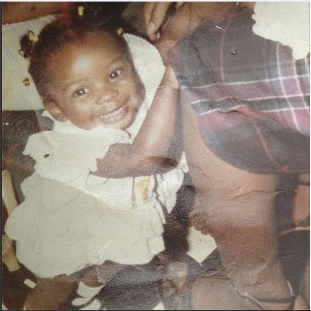
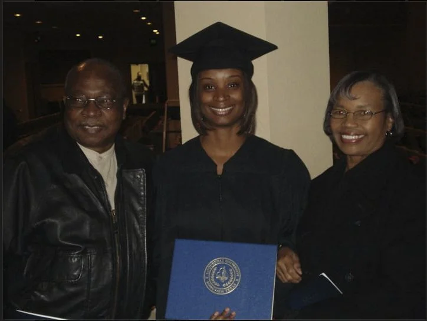

# My Youth Was Spent At Her Feet

I remember as a young girl, constantly being by my grandmother's side.  Actually most of my elders but especially my grandmother.  I'm her first grandchild, born to an unwed teenage mother but loved dearly by her and my grandfather from the very start.  I'm from Louisiana so family and community is everything!

I remember vividly my grandmother telling me how excited she was about my birth in spite of the circumstances surrounding my conception.  She had also just lost her mother to colon cancer exactly two months (August 29) prior to my delivery (October 29).

One soul making room for another, at least that's what the old folks tell me.

In this picture, I am a year old but again I'm at her feet during Thanksgiving dinner.  To some it's just a picture but it's always meant more than that to me.  As you can see she's also holding my hand.  Follow me here.

My relationship with her is unique in that I've always wanted to be like my grandmother.  Gracious, stylish and regal with a touch of feistiness.  Even now at 34, I can "sit at her feet" and talk to her about ANYTHING.

Throughout my youth, I relied heavily on her counsel.  I was never one who wanted to experience her disappointment in me.  As we all know, life is a journey filled with disappointments.  I was pregnant at 20, married at 21 and divorced before 30.

Yet she was there throughout my triumphs as well.  She was there when I finally graduated from college at 31.  That day, she kept telling me how proud she was of me.  Of the woman I've become.  How I've carried myself well.  That she looks forward to being here to continue to watch the woman I will become.

She was the FIRST call for every minor or major event in my life.  No matter where this life has taken me, she's been there for me unconditionally.

Holding my hand.

Wiping my tears.

Encouraging me.

Rebuking me.

It's wonderful to watch the seeds she's planted in my life throughout my youth and beyond continue the grow and flourish.  I only hope to be half the woman she is.  So as I press onward in this journey called LIFE, I will make it my business to soak in every ounce of wisdom while sitting at her feet.

@EarthAngel: Scorpio. Pixie cut wearer. Inked. Maxi dress aficionado. Lover of long reads. Passport stamp collector. Girl Raised In The South and proud of it.
