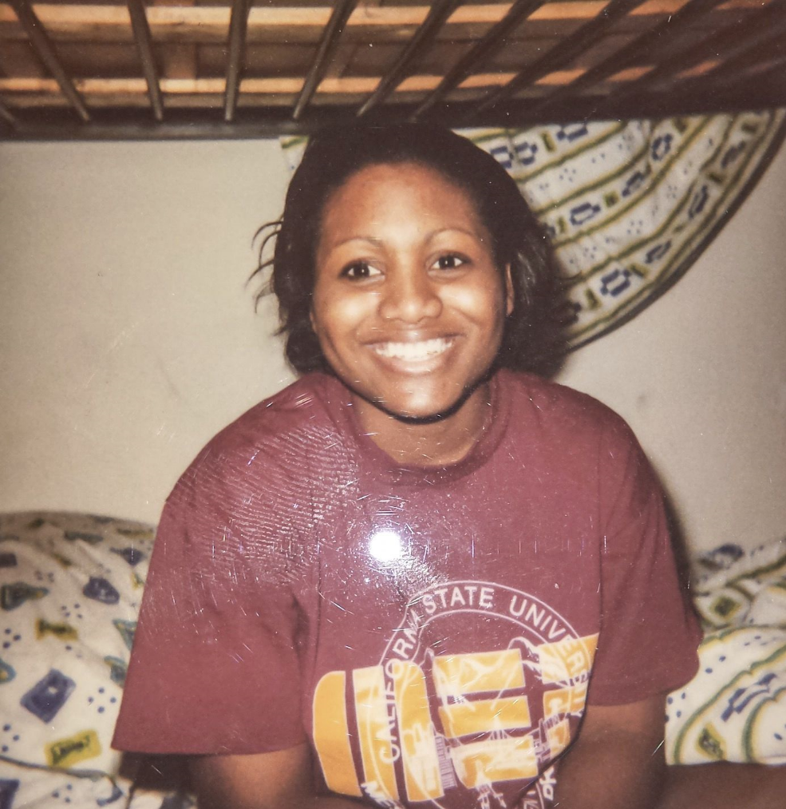

## A Conversation With My Younger Self.

I had a talk with my younger self, but it didn't go the way you think it might. I didn't give her words of wisdom about not wasting time, seizing opportunities or living without fear. I didn't tell her NOT to pursue things with that troubled light skin boy or that mysterious and talented guy is really just a loser with a bushel of untapped potential he will never turn into anything. No. We didn't talk about any of that.

What I did was ask her for assistance. I asked her to remind me of who I was so I could get some of that back.  I asked how she remained so sure of what she knew to be true. How she managed to quiet the inner voice inside that tells her she is not enough. How she manages to wake up every day and smile with such earnest despite the events of yesterday.

She is braver than I. She is smarter than I. She loves herself more than I do. I want to get her back.

She told me to smile bright and show all my teeth even though my cheeks make my eyes partially close.  She told me that to run my own race, despite our asthma and that we play to win or not at all.  She reminded me that we are fearless because we have our family and not matter what happens they will always be there for us.

Her final words of wisdom for me:

**Dream more.**

**Don't hesitate.**

**Share your gifts.**

Haley Rhine, code name PIE. "*Life. Love. Parenting. Truth.*" she writes about these in her personal space [Haley's Comments](http://haleyrhine.wordpress.com). You can also find her on the Twitter [@HereIsMySpout](https://twitter.com/HereIsMySpout), trust her … she has dimples.
