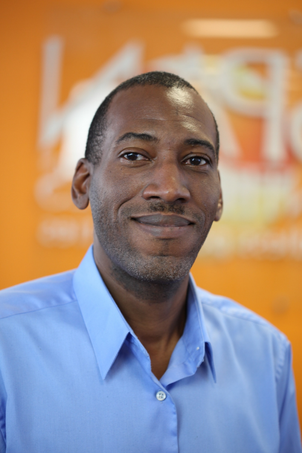

## Youth, Opportunities As Lessons

My fondest memories are growing up on a street called Hull.  It was the first time in my life that I felt I had stability.  We lived in a two-bedroom, one-bathroom home with a semi-furnished basement.  My Grandmother, who lived with us, had the main bedroom; I was fortunate to have my own bedroom, and my mother lived in the basement.

I remember, spending a great deal of my time in my bedroom, with orange walls, yes, orange walls, and stealing chalk from school, imitating that I was a teacher.  I had my imaginary students, and of course, I had my imaginary problem students.  Yes, no classroom is a room full of students who will not cause disruptions.  I knew that I was going to be a schoolteacher, and, I knew that I was going to teach mathematics.

My fascination with mathematics came from a boyfriend that my mother had, his name was Calvin.  I remember him giving me this college Algebra textbook, as a gift.  I appreciated the book, albeit, dust, moldy, and with the smell of being old.  Nevertheless, I looked at the book from the first chapter to the end, I mastered those concepts.  What is more important is that Calvin inspired me at a young age to reach and delve deeper than anyone had ever.  I considered Calvin, my father, my hero.  The man!

Eventually, Calvin and mother would break up, and I honestly do remember an incident that could be classified as domestic violence, witnessing this at a very young age, I just knew that a scuffle happened and my mother's arm went through the window.  At least that is what I think I saw.  However, I was angry over the fact that mother and Calvin had broken up.  What did my mother do to run this man away?

Yes, I blamed my mother. Why?  Because, I felt this was not the first time this had happened; this happened with my father.  Or, I should say the father that I never met.  I have never met my father.  My father was an abuser, he was hurtful, he was a rapist, by legal terms.  He impregnated a young girl, took her from her family, and controlled her with words and violence.  But, when I was young I did not understand this.  I blamed my mother again for never allowing me the chance to have a relationship with my father.  He may have treated you bad, but I'm the innocent one in this.  Or so I thought.

As I grew older, yes, I harbored much resentment toward my mother.  From terminating her parental rights, to giving me to my grandmother, and never being there when I needed and wanted her there.  I longed for the mother that had no longed or could long for me.

See, what I did not understand is that my mother never knew how to love, nurture, forgive, escape, or blossom.  Why, because she was never taught those things and she could not imagine those things.  So, if she was never taught those things, how could I expect those things in return.  Yes, my mother caused me to have a lot emotional challenges.  But, she as well had emotional challenges and they were much graver than mine. Through the chaos, she protected me the best she knew how.

This was my lesson in forgiveness.  I could only heal if, and only if, I forgave the person who hurt the most!  I forgave my Mother! And I'm becoming that mathematics teacher that I dreamed and rehearsed for years.

Jair A. Devereaux

[@juss\_jai](https://twitter.com/juss_jai) - [His story] Future Math Teacher. Passions: #teamPatriots  #teamLakers  #teamEducation

[My Story] Sock Game aficionado, B.U.M. {Body Under Maintenance] Enthusiast, Android, never to return to iPhone user, Politicking' Debater
