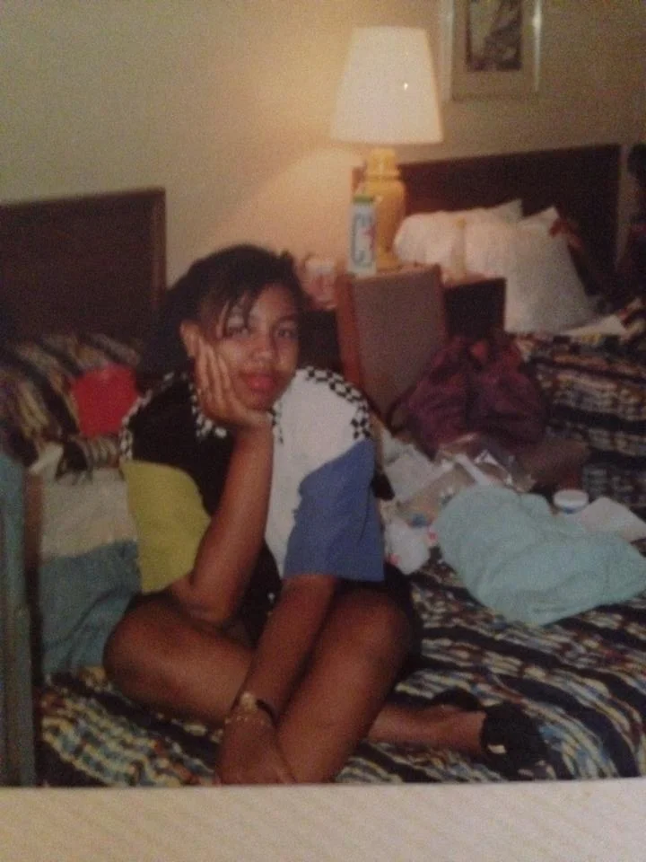

# Being Present

My son, a rambunctious and zealous 4 year old, has no concept of future, past or present.  What matters to him is what matters to him right now.  For a time, my gift to him is the opportunity to only be concerned with his immediate present and not much else.  Soon, life will begin to challenge his innocence and hurl him into the situations that will mold him into whatever he desires to be whether it’s President of the United States, an NBA player or a window washer.  Through it all, he will gain preparation, humility and awareness about what is to become his future.

He will be told as I was told that the “best days of your life” will be in high school.  But why?  Why would those days of conflict, unreasonableness, misunderstanding and yes, disappointment be the “best”.  Over the years, I have pondered the journey through my teens as compared to the awesomeness of my twenties and now my thirties and find that the descriptor “great” does not fit my high school experiences.  However, what I do see in the rearview mirror of my life is the shiny, sparkly remnants of well-worn lessons and hard earned knowledge that gave me the tools that I needed to enjoy my “awesome” years.

At 18 (the glorious bridge age between youth and adulthood-by law anyway), I left my parent’s house to conquer the world.  As a natural planner, writer, and thinker, I jotted down the roadmap to my future beginning with my dream job, followed by my dream man who would take me on several dream vacations while managing to have several dream children along the way.  I then wrote a philosophy, at the time, seemed commonsense – have no regrets in this life.  My youth, naiveté, and ego didn’t allow me to fathom a look into my past.  The point that I missed then was that my past was my future.

The woman I am and am not today is intricately entwined with the young girl who thought she’d die during her first heartbreak…who wrote enough journal entries to fill the Library of Alexandria (if it still existed)…who danced to the sounds of Michael Jackson and Prince then sang with the likes of Phyllis Hyman, Whitney Houston and Paula Abdul…who thought that the news was for old people…and who wanted nothing more than to make an indelible mark on the world.

To live a life with no regrets is not an easy path.  It indicates a level of gratefulness that’s not always accessible, particularly with today’s focus on instant gratification.  It also means that every day is treated as a lesson to be better and to improve on what you were without overanalyzing what you could have been.  At the risk of sounding cheesy, I encourage no one to only live in the past, future, or the present instead simply live.

As I sweep the remnants of my toddler’s hair cutting “practice” on a brand new wig, I am reminded of my own cutting experiment at the same age except on my own head.  My son is my present, my gift that is the finest of my past wrapped in the hopes of my future.  For a while, he will have the opportunity to live in his right now and it is my prayer that he, too, will find that the best days of his life have already begun and will continue until…

J. WIlson Ferguson, on a mission to be positive and spread positive messages.

Our connection to "youth" is strong …

> "Have you ever seen a baby grab their toes and smile? Maybe you've seen them stick their entire foot in their mouth and giggle. Life for them is about toes, hands, and all things simple. Success and it's counterpart are about all things simple. Taking joy in touching my toes is only one of the things that I've learned in life. I'm learning to live my BEST life, one day at a time. What I learn, I'm willing to share so that we can all touch our toes like babies again." - J. WIlson ferguson
