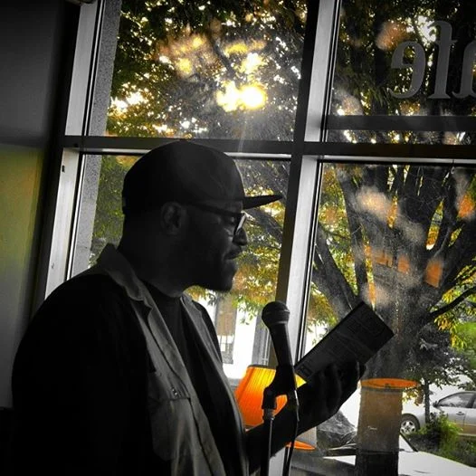

# Black Boy

Your legacy will make no mention of a killer

Your neck will not hang from a vine in history’s mist

The stars align to the frequency of your breathing pattern

Black boy find the will to persist.

I see your kind a lot

Standing by the corner store on the block

On Benning Road,

Or Nostrand Ave rocking a fitted or a durag.

You laugh through your pain and your teeth hurt from grinding.

Your walk like death is on your shoulders

Your designer sneaks step softly over third rails

You look like you just left your own funeral.

I know that look all too well.

You are so noble,

So brilliant,

So afraid,

And so vulnerable

The context is dangerous and the narrative is usual

You make friends with time because dying an old man is suitable.

You dream weave perfect pyramids in your mind.

Tackled body

Guns are drawn

You hold down the block like Ptah on his throne.

Shackled wrists

Prison song

Fear weaves an unjust web

Your blackness is vast as the sea

Your melanin is more valuable than a bag of skittle and a canned iced Tea.

You are hope

You are brave

You are earth and clay

Heroic in the way that father’s choose to stay.

You are hard but hurting

You are Malcolm X in dreads

You are a tuff gong slap boxing spirits to redemption songs.

Remember your wounds are not disasters in your soul

Remember the order of your cosmos is in the pose of a pharaoh

Act accordingly

Talk about that time you were eight that makes you shake uncontrollably.

Talk about the time you were nine and your best friend died.

Talk about...

The deep fears and clenched fists

The deep breaths when death grips.

Scream to the heavens that you need to be free.

If someone tries to stop you

Look at them pensively, smile big, and tell them that...

You refuse to be a high five in history’s jive

Never another black rat trapped

Tell them you are a battle cry.

A buck fifty on the face of shame

A new hymn to a dancing God

Tell them...

You will not be 40oz of Bo jangles doing a boom box jig.

Willie lynched to the limbs of a slave masters soul.

They will not murder you like Sean Bell and Amadou Diallo,

 No!

Tell them you are a dreamer

Drenched in the stench of eighteen summers

Trying to make dollars out of what makes cents.

And trying to keep some sense when you get them dollars

Tell them...

How grateful you are.

That your ancestors kicked through Jim Crow’s doors barefoot just so you can wear shoes.

Tell them about your brilliance and your dominant DNA.

Tell them society might mess around, but nature does not play

Be proud like Garvey in Harlem

Be great like Robeson at The Savoy.

And if you’re asked why you’re smiling

Tell them...

My legacy will make no mention of a killer

My neck will not hang from a vine in history’s mist

The stars align to the frequency of my breathing pattern

I will persist because I am infinite.

Jae October, [lifted this from his profile] "*Poet. Pretty talker. God body goon. Street intellect. Introvert with extrovert tendencies. Habitual line stepper. The jam in your jelly roll.*"  

I couldn't say it better.

Deciphering prophecies through poem(s) and saying peace at [Jae October World](http://www.moetwithmedusa.com)
