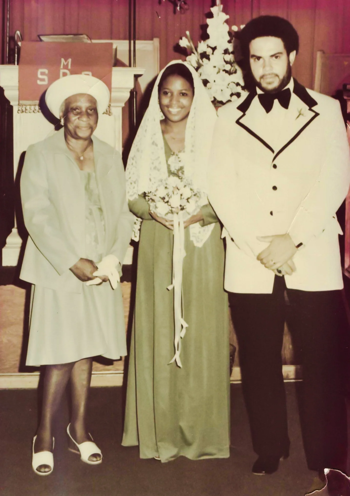

## Youth . . .

adolescence, formative years, early stages, all reference a period of life that some may look back on as most difficult, to say the least. It could be a time when one is trying to “find him/herself”. We often hear leaders telling young people to “be original, be a game changer, lead don’t follow, set your path and follow it”. Here’s the irony, when they do, they get penalized for it. They have been called down for just about everything they do, they way they dress or even the way they wear their hair. In the grand scheme of things, does it really matter what color your hair is or what style you wear it in? Remember when men “processed” their hair and women wore “bee hive” hair styles? Yeah. Countless dreams have probably been squashed because a young person was told “you will never be able to do that, or that makes no sense at all”.

Really?

What about the 12 year old who developed the Braille reading system, or the 14 year old that invented the electronic TV? A teenager developed a device to relieve irritation caused by wearing a cast, a young man developed a cheap way to convert automobile carbon dioxide into oxygen and a child invented the Popsicle and one invented earmuffs. A young man who attends my church along with his lab partner invented a poison ivy detector last year as a science project. Youth have a fresh way of thinking, and they think outside the box and that makes them phenomenal, not trouble makers. Not all the young men who wear the sag in their pants are hoodlums or incorrigible, and not all of the young ladies that wear their skirts short or their tops low are “hoochies”. Yes, some do take it to the extreme but you can’t punish all for the actions of a few. Look at the way some adults dress, what do we say about them? As I think about it, do young people get such a hard time from adults because adults are envious of their frankness or forthrightness? Or are we jealous because they have the audacity to take us at our words to be original, be a game changer, lead don’t follow, or set their path and follow it?

Well, that’s what we tell them ...

Nona Wallace is a wife, mom, grandmother, sister, aunt, friend; woman of God & the greatest inspiration in my life.

Also from N. Wallace on the blog [Forty One Years To Life](http://tramuel.com/iam/2011/09/02/forty-one-years-to-life-n-wallace?q=forty) "Aging"
