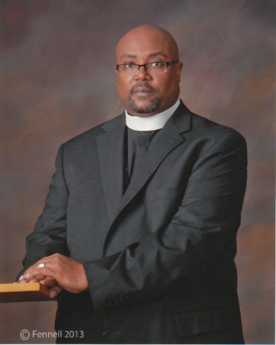

One of the critiques of the Church is that it falls short of fulfilling a vital role; providing a voice during social unrest. The Church, to a large extent is a reflection of our community and many look for counsel; from the Bible and those called to serve.

Rev. Dr. Reginald Boyd, Jr shares his sermon from Sunday August Twenty Four Two Thousand Fourteen where he provides counsel from the Bible and answers "how shall we be at peace in a time such as this..."

The message begins on page three, please read and share your thoughts.

["Warning! A War is Coming!"](/s/Joel-3-Romans-12)

God uses ordinary people in extraordinary ways. Rev. Dr. Reginald Boyd, Jr. is my friend and pastor of Union Grove A.M.E. Zion Church in Bear Creek, NC

Also from Reginald, [Forty One Years To Life](http://tramuel.com/iam/2011/09/21/revrboyd) "Aging"
