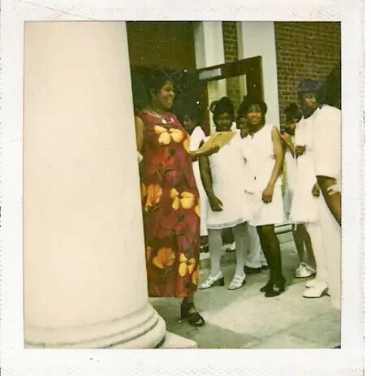

# Youth,

## Pre Teen Years

I remember my pre teen years were frustrating and crazy. My body was going thru different changes and I didn’t look like the girls in my school. I was the skinny kid with no type of shape.  

My fondest memory was the dating scene. In my middle school if you didn’t have a boyfriend or girlfriend you were considered gay. So, this boy named Zaakir and I walked to school together same as his brother and my older sister. So one day while walking, he asked did I want to be his girlfriend. I said sure, he was cute and I really liked him so I was jumping for joy, but I had to play it cool you know how it was. We held hands once or twice. I doubt we kissed, but I got into a lot of fights over him. LOL

Just thought I’d share that....lol

Also now that reflects to my daughter because she is currently in her pre teen years....and she is just like me somewhat. Minus the boyfriend...she better not have no boyfriend!

Sunny has been a long time supporter in these social streets, and the first to frequent my blog.

She writes in her on space, [Spoken Words & Thoughts](http://sunnydelyte21.wordpress.com)

Also you can find her on Twitter sharing laughter and love [@iamSunny\_D](https://twitter.com/iamSunny_D)
