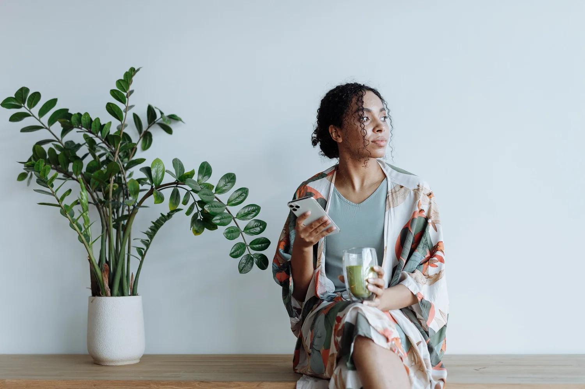

### **4-0, Um Ok?**

Last time I submitted a piece; [I was counting down to 39](https://www.tramuel.com/iam/life-changes-asesq/)! Oh how my days have changed!

You know how they (and really, Who. Is. They?!) say to be grateful and thankful for having the things you once prayed for?

*Yes?*

*No?*

That’s just me who hears those things?

OK, well here I am roughly 8-10 months later - grateful and thankful but also hella tired, anxious, angry, and overwhelmed.

### **What’s happened since 39?**

Well, I went on that solo PR trip and it was everything. I loved it so much that I’m going again for 40!

I left my book club because I couldn’t commit anymore - and I miss my friends terribly.

I applied for, interviewed for, and accepted an attorney position with a Retirement System (go me!).

I transitioned from a full-time stay-at-home mom (read: full-time working mom) to a full-time working outside-the-home mom (read: extra full-time working mom).

I sadly and devastatingly had to put my 16-year-old dog Koko to sleep. This has actually been the hardest thing this year to deal with. Guilt is real y’all.

My husband and I faced one of the milestone parent decisions and got a babysitter for our youngest child (insert immediate tears).

I paid off a credit card and two (large) outstanding hospital bills!

My husband and I petitioned our daughter’s school to let our son in - they said no - that’s a whole other story.

20 pounds on the positive side…arthritis in both my knees…and high blood pressure….

Oh and grey hair.

### **So with the now 10 whole minutes I have to myself in the morning here’s what’s going on internally:**

***I usually question myself: Why are you angry? What’s going on?***

**The Answer:**

Lack of sleep. And lack of support. And lack of rest. And lack of conversation. And lack of community. Where. Is. The. Village?

I’d be remiss if I didn’t recognize and appreciate the women I do have in my corner. We’re all doing what we need to daily to survive and hopefully at some point thrive. There’s a core group I know I can turn to. What sucks though is that in the mundane, minuscule, yet magical moments, it feels like it’s all me. And that really is the root of it all. Who’s checking on me? Who’s asking - hey how’s your day? Who’s sending the random text to say - I know you probably think you’re sucking at life right now, but two kids are alive and thriving bc of you.

Life is hard. Find a community. Find a few communities. Find some friends that can be family. Because when you’re THISclose to losing your entire set of marbles because you’re dressed for work, one kid needs a diaper change, the other is swimming on the floor, your extended house guest is watching you boil and your husband is asking if you looked at and filled in the bare bones budget he created - you’ll need that community to help you keep your job, your sanity, your marriage, your family and your testimony intact.

A lot happens in a year. Journal the journey as my pastor says and live the life but also be aware of every day. Every feeling. It’s a lot. But as I approach 40, I’m hyping myself up but reminding myself too: you’re doing a damn good job in a new set of circumstances, that you NEVER had to deal with before. I’ve never been a working mom. I was working, on maternity leave, the pandemic happened, I was fired while pregnant, had a second baby, and then was circling trying to get out of an increasingly dark and shadowy place mentally and then landed this new opportunity. Was I ready for it? NO. Did I take it? YES. Am I still learning and searching for balance - HELL YES! But what I do know is this - I’m still here. I’m still me and this “big change” to a new decade is another opportunity to mold the life I want. Take the steps I need to take. Embrace who I am. Love who I am. Be confident in who and what I am. Find that voice that’s been too timid to speak boldly.

Here’s to the impending new decade. I’m ready for you - lemme just finish making baby girl and baby boy’s lunch real quick.

*AS Esq.*
