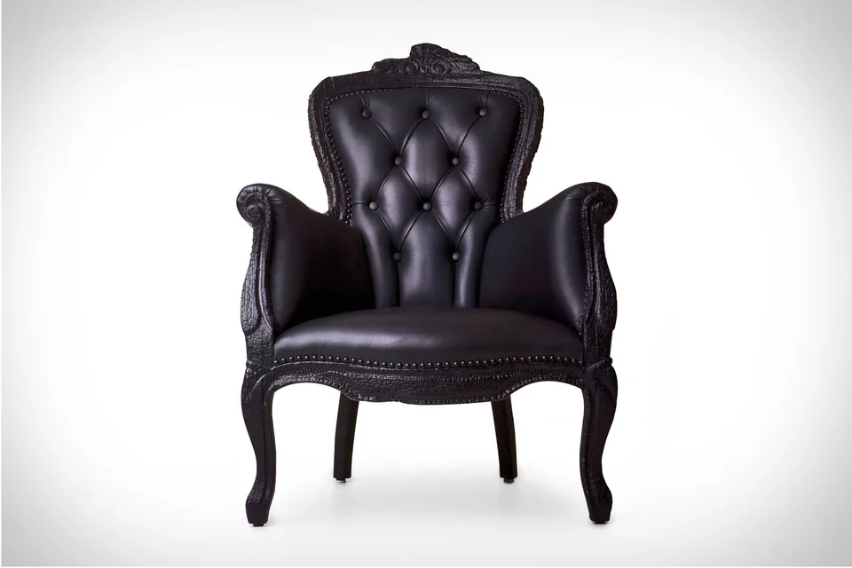
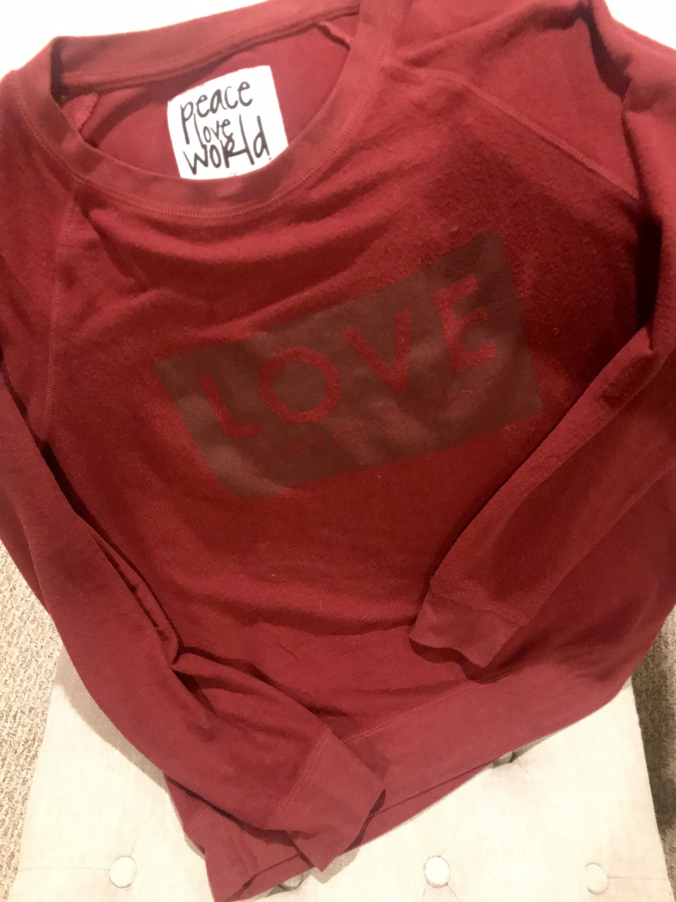

Our wedding anniversary is approaching and there have been a lot of indirectly related conversations about relationships, love, and marriage. Not between Mrs. T and I but in these social streets.

A common theme, although no one sees it as such is jealousy.

Jealousy is an emotion that is characterized by overwhelming insecurity. However, it is rarely expressed in any single behavior nor have theorists and researchers agreed on any defined sets of behaviors involved. I know this because I talk to theorist and researchers every day.

Science.

One of the things I have not had great concern of in my relationship and marriage with Michelle is jealousy. There is a unique quietness involved in the security of the heart.

### However

Yesterday while we were in Home Goods the quietness was disturbed by a bustle. We moved in silence from housewares to furniture independently and dependently until we spotted something that we wanted to share with each other. We were both attracted to a set of leather chairs, as I plopped down in the chair I hear Michelle tell another woman *"These are spoken for"* and we all had a little chuckle. At the cash wrap, I found out she actually said: *"He is spoken for."* Apparently, this woman was admiring my shirt a lot and for too long, and by my shirt I mean me. I didn't notice because Michelle is the avarice of my eye.

Math.

I'd like to believe this was more about envy than jealousy. Envy is often used interchangeably with the word jealousy but as an emotion, its definition differs. Envy occurs within a person when they specifically lack another person’s talents, (for this purpose husband) and/or advantages and specifically desires them for themselves.

Although I did have on a nice shirt.

Michelle did too ;)

I remain
