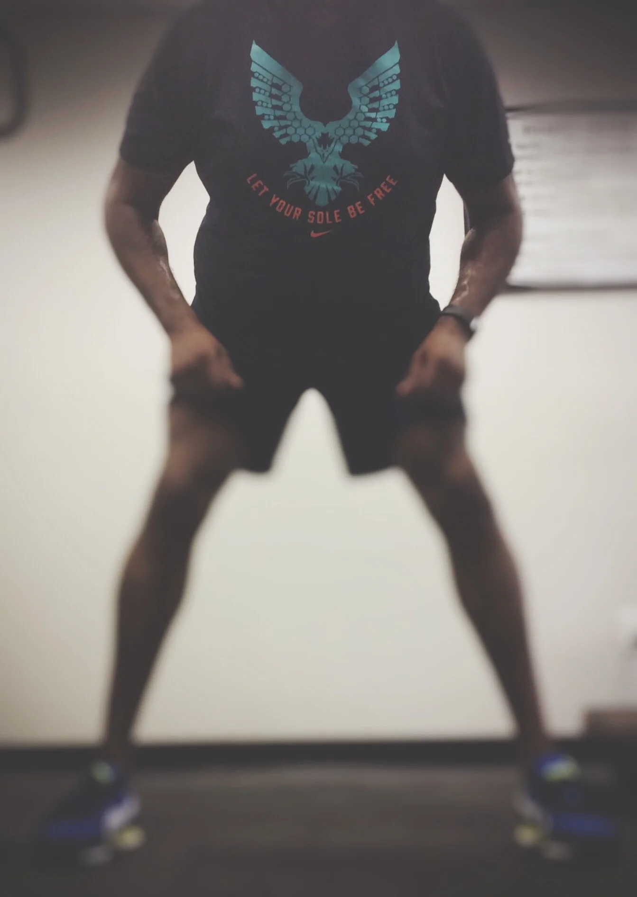

A few weeks ago I was inspired by a former co-worker. I had begun to see her in the gym; I noticed she had dropped a few pounds from when we worked together, from my point of view I never thought she was in bad shape. Perhaps I Am biased, because I like grown woman weight. Read: Curves.

Anyway … every morning like clockwork we would end up at the gym around four thirty in the AM. Crazy right? Maybe, considering I do not head in for work until ten in the AM. The early arrival is so that I could use the equipment sucka’ free. 10 Bands, 50 bands, 100 bands, fuck it man. Let's just not even discuss it, man, O-M-G. Maybe her story is similar. I’ont eeen know.

But … I’m off track again, keep up. I signed up with the YMCA (primarily for access to swimming pools as the Aquatic Center is undergoing much needed repairs) … the point. I had stop going to the gym and started spending more time at the Y. So I did not see her for a spell. The only limitation I’ve experienced with the Y is that it does not open until five thirty in the AM. My internal clock wakes me, often without notice, at four in the AM. It is hard for me to just lie down and return to sleep so I put that monster to work. What time is it? Gym time.

Fast forward …but backwards to three weeks ago. I run up in the current old gym and my former co-worker is in there and has dropped even more weight. Yeah shout goes out to Nike, checks all over me. I need a FuelBand just to see how long the run has been. Except she is using a Fitbit. I tell her she looks amazing and ask her what she is doing. She explains to me her diet, workout regimen and water intake also that she bought a Fitbit. I Am intrigued because my Nike Fuelband is starting to fail. Yeah, I wanted what she was having so I went out and purchased a Fitbit Charge HR. Found a good deal at Best Buy $49 dollars off but only for the black band. #BlackBandsMatter

If you have been reading my blog, you may have noticed I’ve dropped a few pounds myself. I began by stripping as much fat as I could by walking, running and light strength training. When I felt I had lost enough I began the process of adding more muscle. I’m not interested in body building, Oz grunting and dropping barbells but becoming more lean, fit and strong. #Titan

At my lowest, I dropped down to 225lbs however I still had a considerable amount of body fat. The fat is primarily in my dunlap area (belly done lapped over my belt), lower back and chest. Once I started the weight intensive training I definitely began packing on more muscle. My weight also increased to 240, I chalked it up to extra muscle, I mean muscle weighs more than fat right? Right?

I became comfortable, I cannot lie, I thought I could out run, out lift and out crunch a bad diet. I was eating very well, however I was also snacking on unhealthy foods. Maybe they are ok in moderation or if you’ve already achieved your goal. It made sense tho’ with “apps” telling me my calorie goal was complete, people telling me how good I look. I believed I did not need to lose any more weight. The app may have been counting calories, but all calories are not counted the same.

I think about how I viewed my co-worker. I think about how these apps tell us that our goals are complete. I think about when I was three hundred plus pounds and people would tell me I was fine … and there is the lesson.

Don’t allow anyone or anything to dictate to you where your finish line should be. Don’t wait until the perfect time to do something because it may never come. Do it now, and with vigor.

I Am

Let Your Sole Be Free
