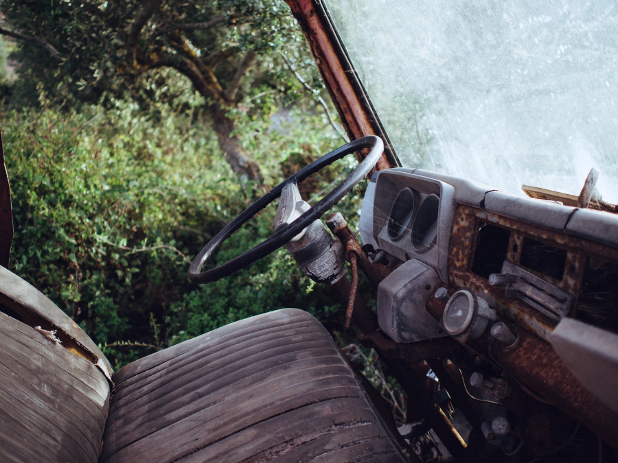

Caught up in a reverie.  One Summer in D.C., while playing in an abandonded pickup truck, I cut my left knee on an old, rusted hubcap. I'm horrible with time/age, I imagine I was five or six. I recall not being able to sleep at night. In part due to the pain but mostly by not being able to move/shift my body into a comfortable position.

We were half-way through the Summer, half-way through our visit. Everyone went on with life. Life didn't stop because I had nineteen stitches (nine, the Dr. told me to lie) and couldn't run, chase or play hide-go-seek. In many ways my sister and cousins related to me (my injury) in ways that were loving but also challenged me to grow.

Lol, I'm just serious... at times we expect others to unravel the intricacies and subtleties of our lives. Family and friends (read: genuine friends) listen when you hurt, problem solve with you when you need help & "turn up" for you when you win.

Don't play victim or martyr, accept responsibility for the consequences in your life.

At times the best tasting medicine is self-prescribed.

I remain.
