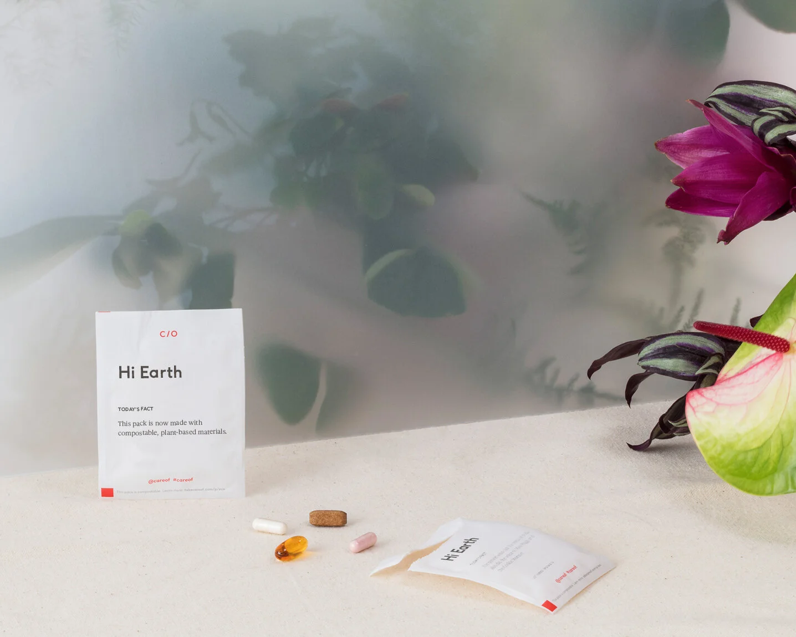

I take @CareOf Vitamins daily, on each pack there is a quote or challenge, I generally ignore them so I Am unsure if they are repetitive — Today, I will play.

*Today’s Challenge*

*Write down a list of what you’re grateful for this year, and take a moment to feel lucky for what you have.*

Maestro – His unconditional love is inspiring, even if Michelle is his favorite.

Books – If music is medicine for the soul, books feed it.

Music – Speaking of, music is my drug of choice and sometimes I need a little extra medicine.

Friends – efriends and also those people not on digital lists that I see in person.

Time – Twenty-four hours in a day and you only need eight hours of sleep. I win.

Art – Brings me BIG emotional highs.

This is not an exhaustive list because; family, love, good health… but I’ma stop here because realizing all the things we are grateful for is the first step, practicing gratitude is what we should be doing.
