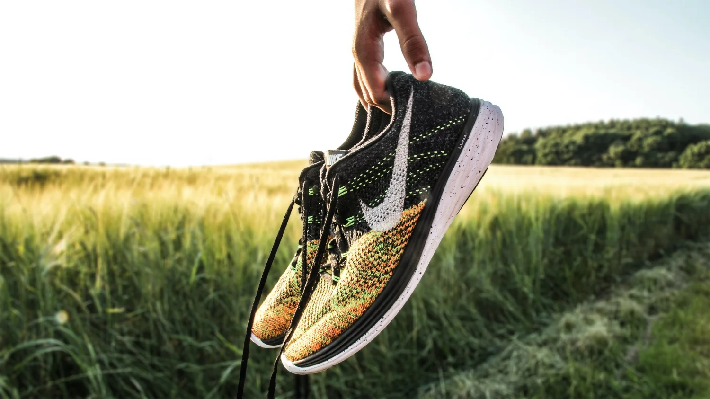

In tête-à-têtes with living souls about moving from a company that I worked for twenty years I suggested that I was content. At my BIG age, working since fifteen and six months, I also talked about balance.

### **Balance**

**Of Work & Life**

*What does that look like to you B?*

— A role as an individual contributor being paid a livable, respectable wage, with (*more than*) enough to pay my bills, save a lil’ and to facilitate the things’ that make me happy with full autonomy and trust to do what is asked of me with little to no supervision.

### **Content**

Seemingly they believed I had that balance in my former role and within those conversations *the mob would pout and ask querulously*

*“Why did you leave?”*

— ‘Cause during the work week; they saw me rolling, they hatin’, trying to catch me riding dirty… I would be relaxed, drinking coffee inside a shop with my legs crossed drinking out of a ceramic mug at 9:30 AM, walking or running Freedom Park at noon, and getting a haircut at 1:00 PM.

They view the move as a contradiction, as an indication that I was NOT content. However I Am extremely content with my life, with what I have and with who I am.

kənˈtentm(ə)nt|*noun*

What it is *-*  A state of happiness and satisfaction.

What it isn’t - A matter of being pleased with your situation in life and never wanting to improve it.

The move was/is an improvement providing me greater balance. A matter of being fulfilled, knowing that I will never stop trying to improve.

***“Happiness is self- contentedness.” -Aristotle***

We choose whether we are happy or unhappy.

I Am

