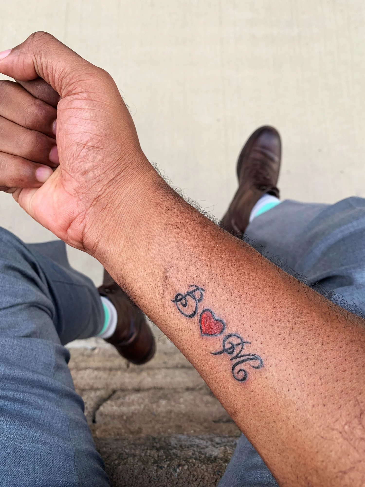

I’ve been holding back from sharing the good things happening lately, Mrs. T & I, our families (immediate and extended) all are being blessed this year with very few antipathies. Health, finances, love – general overall happiness and quality of life.

But this ain’t about them,

keep up.

In a small sub-set of ‘other’ relationships; friends (read: not people on digital lists), co-workers, connections on the street (read: real and social media) all are going through something.

Their opportunities are the opposite of my gifts.

The most common ‘opportunity’ for most is within their relationships; talk of separation, divorce or infidelity. Others are experiencing job loss and or underemployment (at times worse than being unemployed.)

I am generally reserved and don't get excited about (too) much, however the high Mrs. T and I are on… *health, finances, love – general overall happiness and quality of life* is often muted by interpersonal awareness; noticing others' feelings and being able to communicate this awareness empathetically.

Harder we fall in love.

Harder we fall in despair.

Every now and again people can use some compassion without strings.

I try to offer that.

In turn, I appreciate all of the genuinely kind connections I’ve made in these real and social streets and our compassionate exchanges.

I Remain,

Matching tattoos; B loves M, M loves B
