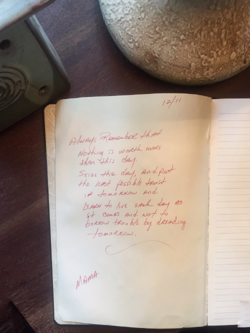

> Always remember that nothing is worth more than this day.

> Seize the day, and put the least possible trust in tomorrow and learn to live each day as it comes and not to borrow trouble be dreading tomorrow.

My mama be knowing.

I remain.
