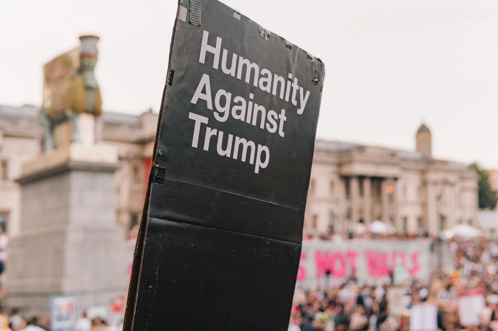

This was sitting in my (blog’s) draft folder, I’m not sure if I finished this and posted it here or somewhere in these social media streets. Also, I’m lazy and refuse to search and verify however, the content is relevant on this day.

The energy surrounding our current political process, current election cycle & Supreme Court Nominee provide opportunities for discussion.

Picture a politician sticking up for a colleague even in the face of widespread criticism, a great example of an old Latin saying corvus oculum corvi non eruit, meaning "a crow will not pull out the eye of another crow." It’s essentially the same as "honor amongst thieves," and refers to complete solidarity amongst a group of dumbminded people regardless of the consequences or condemnation.

Shout out to my High-School Latin teacher.

Aside from belief, political affiliation or lack thereof, our blood runs a shared red. You would be hard-pressed to change anyone’s point of view, but if you listen closely to the subtext most of us desire the same experiences for our lives. We need love, to be seen, heard and understood. The problem is with the facets of entitlement, egocentrism, ethnocentrism, essentialism and the most distressing ism; racism.

The actions of those who engage in these or will engage in it in a number of ways; from individual to individual, legislatively, culturally (from law enforcement, banks, schools, etc.) to of course the media tell us that we are undeserving of love, do not need to be seen, do not need to be heard or understood.

Conversations at work, the gym, standing in line at the grocer and in my social media streams, across all relationship sectors; social-media connections, work, friendship, and family point (directly or indirectly) to a hierarchy of needs.

I believe we all share an expanded hierarchy of needs but differ ideologically on how to achieve them.

> *Goebel's Observation On Utopia: If everyone believed in Peace, they would immediately begin fighting over the best way to achieve it.*

With the election of Ronald McDonald and his sheep, there are many who would deny basic biological and physiological needs like air, food, drink, shelter, warmth, sex, sleep, etc.

I’m just serious.

- Water – Flint, Michigan
- Hunger & Poverty
- Homelessness
- Women’s Reproductive Rights

Deny safety needs like protection from elements, security, order, law, stability, etc.

- Climate change denial
- Police brutality
- Children being held in cages
- Gun control/school shootings

# *Vote.*

I Am
