Probably.

# My Favorite Apps Two Thousand Seventeen

## & by favorite I mean most used.

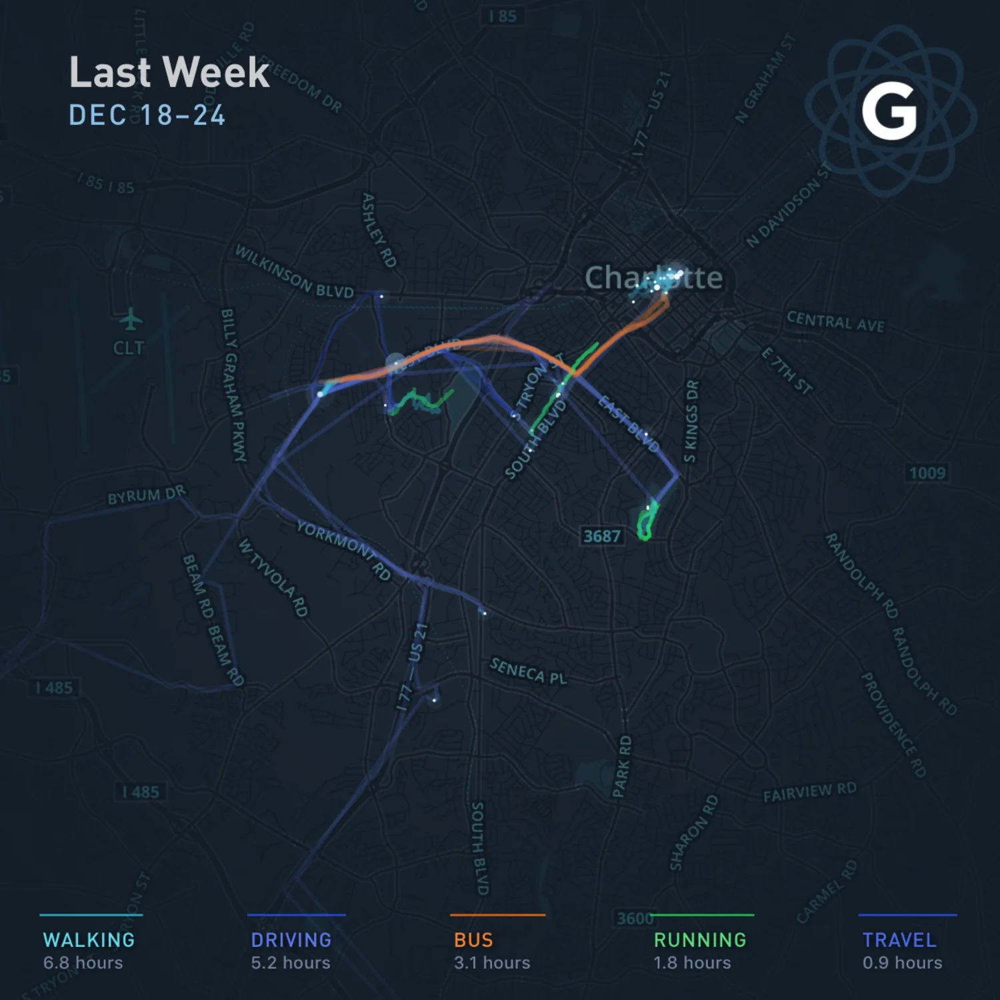

### Gyroscope App

*The new OS for the human body*

There are a myriad of ways to track how much you’re walking, running, biking, swimming or sleeping. Gyroscope collates all of that data and turns it into a single, easy to understand overview. Gyroscope wants to be that digital glue that brings your life data together.

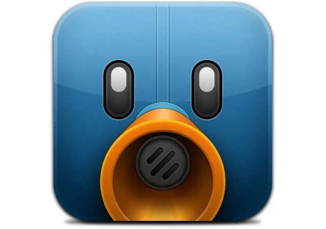

### Tweetbot

*A Twitter Client with Personality.*

Tweetbot has been my client of choice for years, for both iOS and OS X, and despite installing/ uninstalling other software options, including Twitter’s own official apps, I’ve stuck with the Tapbots products. Tweetbot better reflects how I use Twitter; an organized, clean interface and most importantly, it has a strong set of mute options, which can be used effectively to avoid unfollowing or blocking people or groups during periods of time (or even forever) that you don’t want to have their tweets in your timeline.

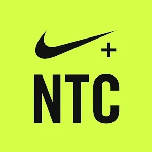
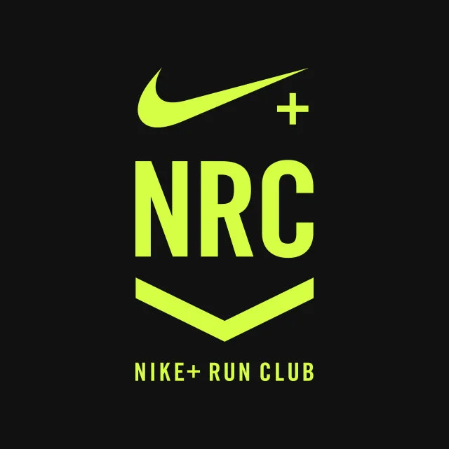

### Nike Apps | NTC (Nike Training Club) & NRC (Nike Running Club)

*Just Do It*

I'm too deep into the Nike ecosystem to try using anything else. I was an early user of the Nike+ Fuel Band, I own and use a Fuelband SE. NikeFuel is a universal way to measure movement for all kinds of activities and this year I earned 1,079,036 NikeFuel and ran 426.7 miles. There are beginner, intermediate and advanced levels, and specific workouts that fit in each category.

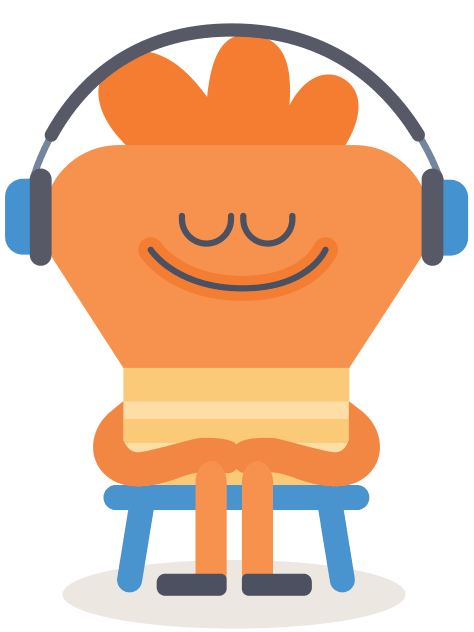

### Headspace

*Meditation made simple*

I started meditating because I wanted to fill the gyroscope app with data. After a few days and becoming more familiar with the practice I found my own meditation groove, and Headspace has since become an invaluable tool that I use each day. For me, it has improved my concentration, encouraged a healthier lifestyle and increased my self-awareness.

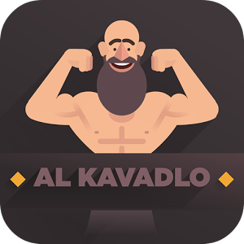

### Working Out

*We're working out!*

I love this app,bodyweight strength training and calisthenics workouts when you can't get to the gym - Work out alongside an animated Al as he takes you through more than 40+ unique workouts and over 90 different progressive bodyweight exercises.

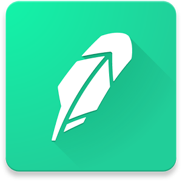

### Robinhood

*Investing.* *Now for the rest of us.*

Robinhood is a free stock trading mobile app, offering an easy to use interface with excellent integrations to easily deposit money and begin investing. This is good for Low cost stock trading and beginners looking to start trading. When I first started with the app, it was mobile only and some trade strategies were not available - Today they offer a web version and have added option trading.

### ProtonMail

*We're building an internet that protects privacy, starting with email.*

ProtonMail offers free, end-to-end encrypted email through a web interface and mobile apps. If you do not own a domain, this may not be for you as it does not offer IMAP or POP access and cannot collect mail from other accounts.

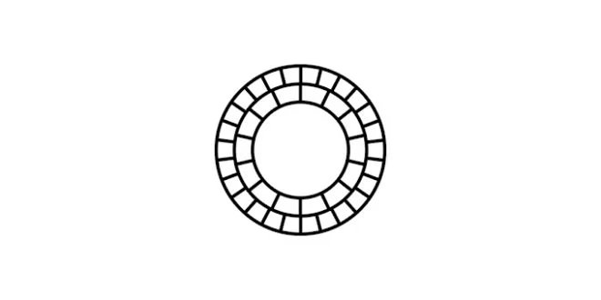

### VSCO

Create, discover, and connect

I use the in app camera to capture most of my images instead of the native iPhone camera. VSCO provides full RAW image support including RAW capture, importing and editing.

### Honorable Mention(s)

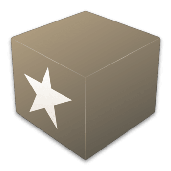
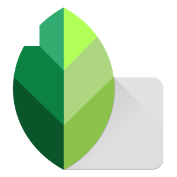
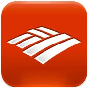

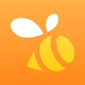
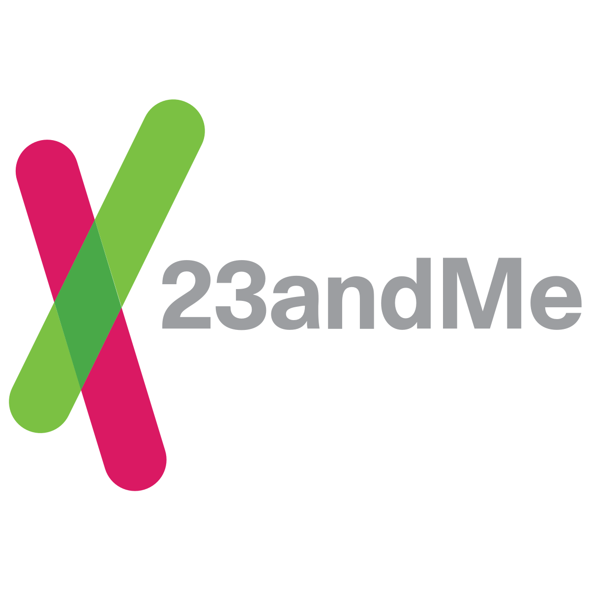
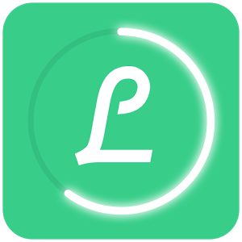
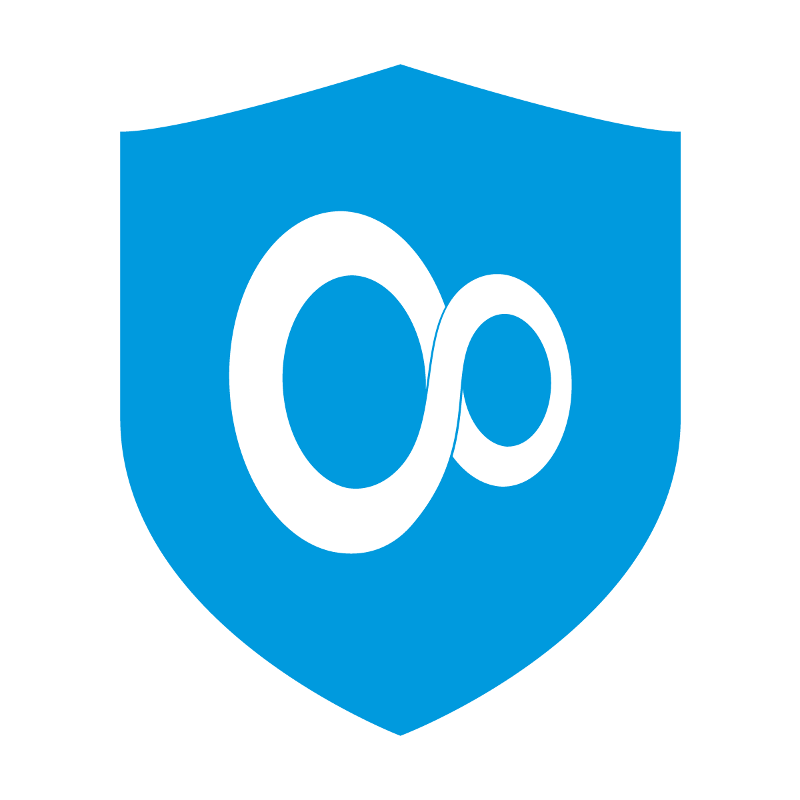

What are your favorite apps and what mobile platform are you using?

I Am
