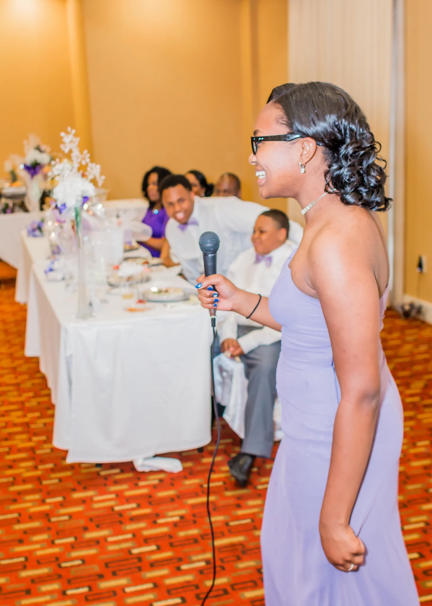

### **Write your ideas, thoughts and experiences down.**

Geneva’s birthday is today, all she asked from me was a letter. I bought her a journal and added the following inscription …

*The things you need to know about living can be learned from a genuine and unbroken attempt to write.*

*My life, by extension of writing; love letters, random observations, lies, stories, blog post and research papers has been enriched by attempting to capture the elements of a situation and combining bits and pieces with the big picture.*

*I encourage you to jot down your experiences; the taste of food, how dancing and singing make you feel, what good music means to you, your thoughts in the moment you’re behind the wheel of a car all by yourself.*

*Becoming mindful of your thoughts, will make you alert to new perspectives.*

*Your life, by extension of writing, will define, shape and help you articulate your world view more effectively.*

*Happy Birthday!*

*Love, Big Brian*

I’ll save the letter for her high-school graduation.

She also asked for a Tragus Piercing, these kids today.

Geneva's well wish during wedding

I Am
