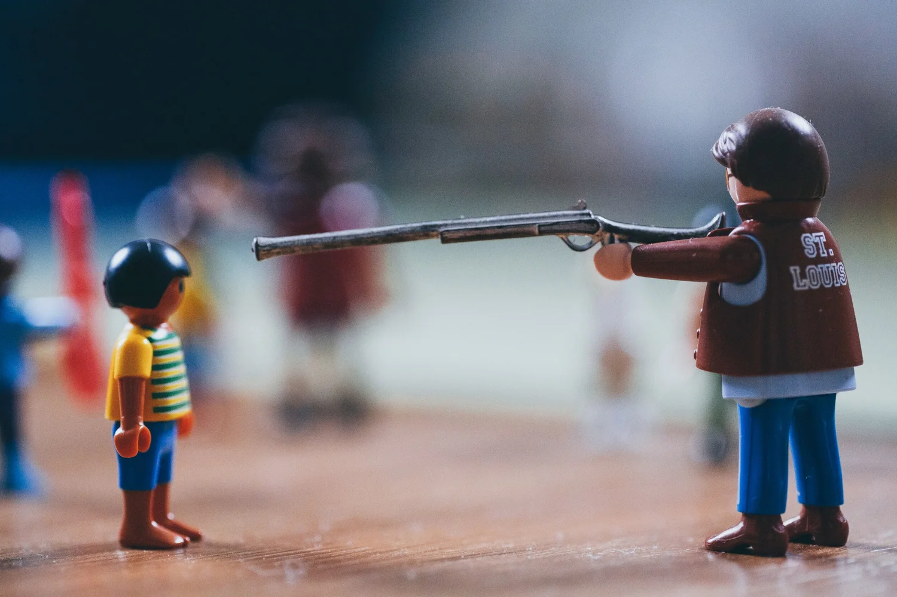
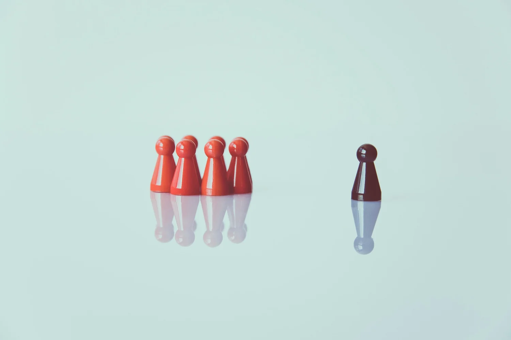
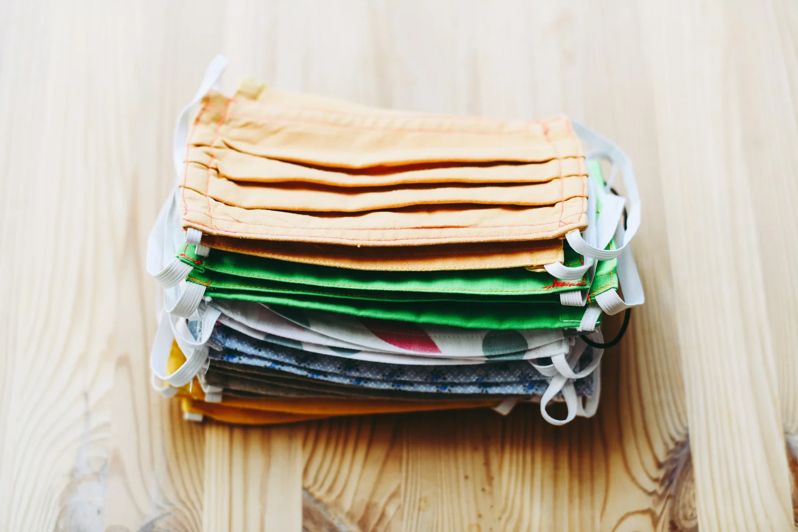

> Before graced with colour, there’s only clear flesh, blank slates of unrest.

I’ve been supporting local business during the pandemic, it is doubly dynamic in that it allows me to get out of the house for a minute. I spread the love between three coffee shops all within a 5-mile radius of the house but in different towns; Mint Hill, Concord, and Harrisburg. Also, there are two breakfast spots I frequently support, I love to cook at home because the quality and value just aren’t there anymore for most restaurants. I Am using "to me" language but also, maybe because I Am Uncle Brian & I (secretly) feel that I prepare food better. But I, like most of you, Am tired.

Tired of cooking.

Tired of eating.

## **Tired of the police killing us.**

This morning I stopped at one of the breakfast spots where there were 6 State Trooper patrol Cars parked outside. That is insignificant by itself, I put my tool in the glove box, fixed my face (mask on) & walked inside. Gathered around a BIG round table just as you enter the Trooper’s sat in their summer attire; khakis, black polo shirts, and boots. All eyes on me; no head nods, no salutations, no well wishes. Also inside of the restaurant, as part of the latest phase -- indoor seating is allowed, sat a couple breaking bread, drinking coffee and surfing the world wide innanets’.

No one had on masks but the employees & me.

The trooper’s being representative of the State of North Carolina & interacting with its citizens should at the very least wear masks. Generally, I have some anxiety being around overseers... I mean officers but today I was relaxed as I hopped out of my black car, with my Nike sweats and black sneakers (Jordan 1 Low) sagging, fuck implicit bias, call it what it is

# **Racism.**

Also, I Am not returning (ever) they messed up my order and I did not realize it until I got home, always check your bags. Karen was nice but I wasn't going back to the store - refunded. Additionally, I won’t patronize a place that won’t require their customers to wear a face covering.

Harm None,

B
