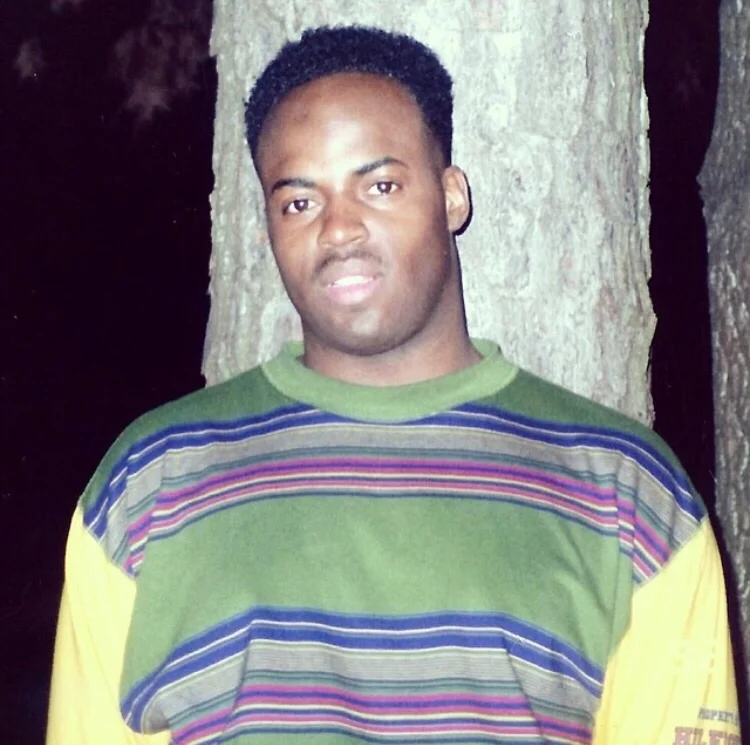

Back in the day when I was a teenager, before I had status and before I had a pager …

**1991**

When I moved to Atlanta I became quickly enamored with the amount of melanin in the metro area. One of my favorite things to do involved people watching in Underground. One day while taking in the sights, sounds and smells a young woman approached me from the stairs of the Dollar Store. She stopped and chatted’ me up. Most of you know from previous post that I have no idea when a woman is hitting on me.

She gassed me from the start,

*“You have a unique look, not like men from around here. Where are you from?”*

& she never turned it off; we may have talked for fifteen minutes before she closed with,

*“Are you going to ask me what’s in the bag?”*

I obliged to which she responded,

*“I bought underwear, soap and deodorant. When I saw you on the train I knew I wanted to go back to your place.”*

We ended up riding MARTA to her apartment [I’ll allow you to fill in the blanks here] Afterwards I went home. Later that night we talked on the phone for a few and dassit. I never heard from or saw her again. I’ve never shared that sexual story with anyone; it exposes a battle with foolishness and ill motives.

Michelle and I are honeymooning with few antipathies. Lol I’m just serious, when you’ve known someone for over fourteen years, to quote Chris Rock,

*If you haven’t contemplated murder, you ain’t been in love.*

Last week, I had four separate conversations about intimacy in relationships. I found it hard to be objective, realizing I might be biased being that I’m all in love and shit. So I thought about my past experience(s)

Our sexual stories can produce feelings of pleasure, pain, anticipation and dread. Sex can be looked at as a loving expression or overcompensation for our real or imagined inadequacies.

If love is blind then lust has 20/20 vision.

& since I’m quoting Chris Rock,

'*A man (or woman) is basically as faithful as his (or her) options.’*

Take care of home. That should be the only option.

Blessings on blessings on blessings; Look at my life man that's lessons on lessons on lessons.

I Remain

