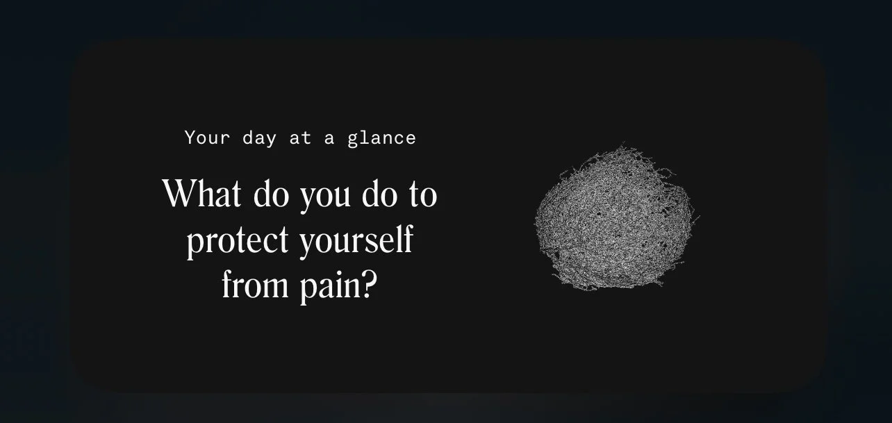

# **What do you do to protect yourself from pain?**

## **I protect myself with a complicated set of traps & defense mechanisms.**

I received a lot of private *feedback* on this sentence from my [***post***](https://www.tramuel.com/iam/life-course-b-tramuel),

***"I could be a great boyfriend, partner, or husband except… I do NOT want to do the work."***

Mostly you need to heal, you're hurt, and you need time *feedback.*

None of us are ever fully healed. What is important is finding someone who is not afraid of their emotions. A person who does not suppress what they feel, and can gently be present to their inner ups and downs.

***"The Radical act of asking for what you need"***

...until then, love will continue to be a temporary emotion wrapped in madness.
