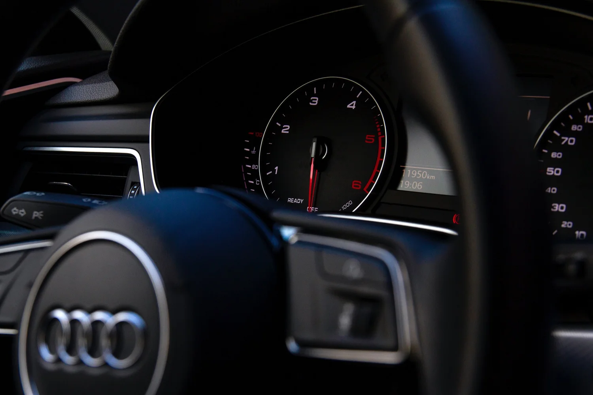

I’ve had anxiety about driving after my car accident. It comes and goes, an ongoing general feeling of uneasiness. Memories of the accident replay over in my head, triggered at times by seeing an Audi or a Zaxby’s. Not so odd as Mrs. T and I stopped to get Zaxby’s on the way home right before the wreck and I still smell the food, coke and sweet iced tea.
