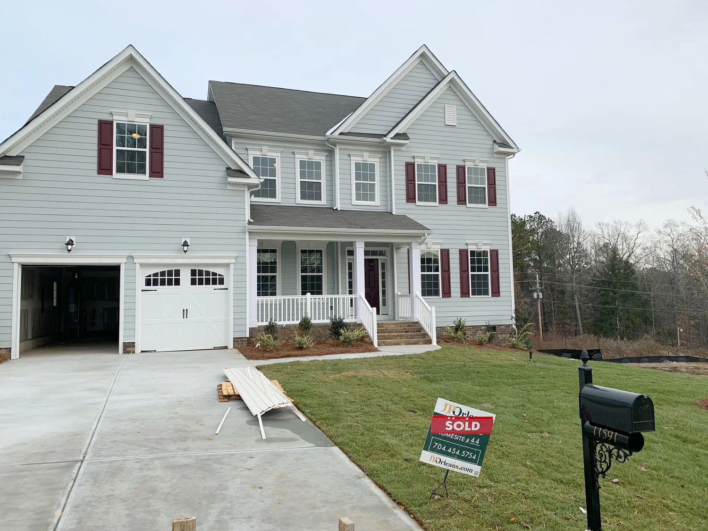
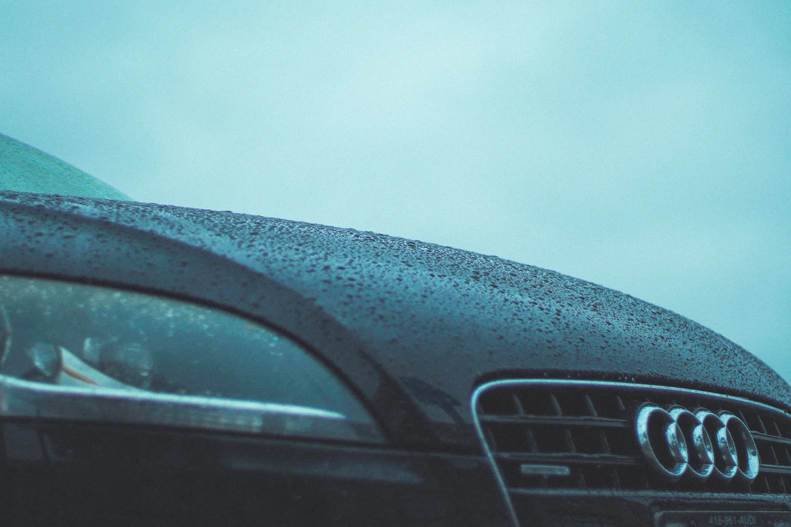

# But Satan Been On His Shit

## **Blessed**

Two Thousand and Eighteen for my family; immediate and extended has been incredible. We’ve had some lows but mostly highs. Personally there is no greater example of God being the greatest and Satan trying to tear everything down than the last few weeks of this year.

### **God is the Greatest**

****Michelle and I closed on a beautiful new home on December 19th. Without any of the typical complications or stress that comes with purchasing a home, not to mention building from the ground up we remained stress free. Working directly with the builder and our lender and no real estate agent, we received special considerations from both the lender and the builder — our closing costs were almost nonexistent.

### **Satan Been On His Shit**

Most of you know I ride the bus to work. In part because I B’ road raging and I like money. I kept the cost of parking, gas and emotional well being stored in my bank account and have not had a car payment for a few years. When Michelle decided she wanted to live in a rural setting 👀 I was going to need a car.

The Audi A5 was the avarice of my eye. Short story short, the day after closing I bought an Audi A5 but owned it less than 9 hours before it got Hulk smashed.

### Everyone walked away.

Outside of my IG stories (only a handful of you look at 👀) and a few random tweets, I remained humble throughout the whole process and in awe of my blessings. In addition to love, peace, health and happiness — God blessed me with paper. I switched from Options to Equity trading and became surrounded by forward thinking, likeminded people who are closer to me in age making it much easier to relate to and support each other inside and outside of work.

More money, fewer problems.

I stayed’ thanking & praising God and when the accident happened I searched for a lesson or an opportunity,

Almighty God give us wisdom to perceive you,

intelligence to understand you,

diligence to seek you,

patience to wait for you,

vision to behold you,

a heart to meditate upon you,

a life to proclaim you.

“Sometimes, the lesson isn’t for you”

Remain Faithful,

I remain.
