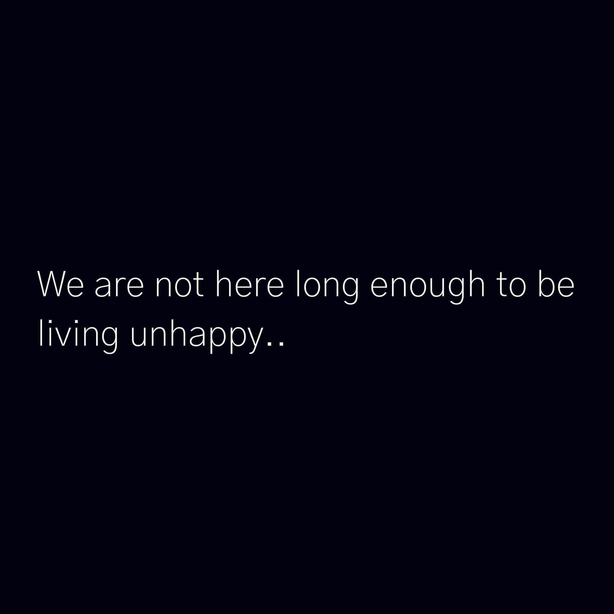

Life 10 years ago was so full of hope, fully believing that although I’d missed the mark of gaining life’s expected treasures ie. marriage, kids, perfect career, and house, I still had time to gain them and life as I had dreamed would/could still be grand. Then reality hit. Hard. I got married. And most days it was not a bed of roses. More like thorns. Had children who are now teens. And if I could put them back… nevermind. Purchased a  house and even that wasn’t all it was cracked up to be.  It turned into a house of horrors. All that to say- things that I thought would make me happy, fill my inner spirit, and bring me complete joy had done anything but. Fast forward to this year, years later, and I’m still unhappy. But, I’m on a different journey now.

The path, dreams, and goals I had before aren’t in the top 10 anymore. I’m at a new phase where my thought process has transformed and evolved. Now I’m entertaining self love. I’m looking for inner peace. I’m seeking happiness. And I’m searching for the little joys in everything. I’m choosing to love and/or leave people right where they are. I’m striving to be a light for others. And I just want my life to be more meaningful instead of being more tangible.

I recently attended a Homegoing Service that was a true Celebration Of Life.  In getting to know her, one thing that forever touched my heart was while she was transitioning, she was telling everyone how to live.

**“Go live your life”**

Live. That must mean be content in where you are, who you are, what you are doing, who you’re doing it for, and who you’re with. Kinda circles back to the self reflection and learning/knowing what will really make you happy and allow you to be content.

*I heard you NW and I’m goina try harder to be honest with myself about what makes me happy from here on out.*

*Love,*

*Your wanna be daughter in law*

My life has sucked thus far if I can be honest. Gosh how many years have I wasted?

Maybe not anymore.

