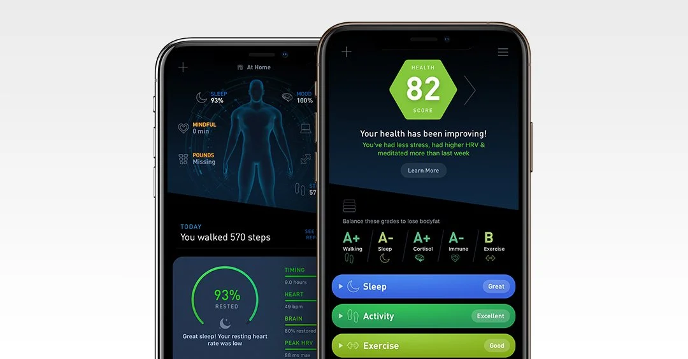

The illustrious Mr. Tramuel has been a fairly long time Twitter connection of mine. We've both enjoyed our online interactions with each other over the years but what I remember most about those interactions is centered around our physical fitness journey - specifically us both using a fitness tracking app called [Gyroscope](https://gyrosco.pe/)

When we both started using this app (along with the Apple Watch Fitness app), Gyroscope was free, but that being a minor note, the key is our focus was maintaining a physical fitness lifestyle. For me, it has been a lifestyle. When asked my age, I'm consistently met with disbelief (on October 19, I'll be 60 years old). My doctor has told me I look at least 10 years younger. I feel good physically and have been blessed to not need being on any medications. My weight and BMI is normal for my height, and weight training workouts (my regimen consists mostly of bodybuilding type exercises) seem to work quite well. For cardio, I run - JUST A LITTLE BIT (LOL), but all in all, it does make me feel good and with a good 7 hours of sleep each night (which I admit I struggle with getting based on bedtimes LOL),

I think being disciplined with a regular exercise program and working into your lifestyle is very important, BUT at the same time, noting that it's not a difficult thing to do. Being mindful of your diet (I believe in the 'everything in moderation' approach) is a great help also. I've made a conscious effort to avoid alcohol and have never smoked, but we're talking about aging here. One thing that has been UNAVOIDABLE to me...LOL..is I notice my body takes longer to heal. Last Christmas Day, I took a tumble down our basement stairs and ended up breaking my fall on my knee. I firmly believe that had I not been working out, doing leg exercises over the years, I could have injured that knee, a part of the body that we all have to be mindful of at this age. The extent of that fall was some very minor swelling, but it took about two weeks to subside, even though it didn't prevent me from working out. That is one example I’ve experienced with the healing timeframe being longer.

In any event, cars age, mechanical devices age, etc....and so do we.

Maintenance to the previous examples helps prolong longevity...and does physical fitness.

Thanks for reading.

Best,

[Doug](http://www.vibesnscribes.com)
