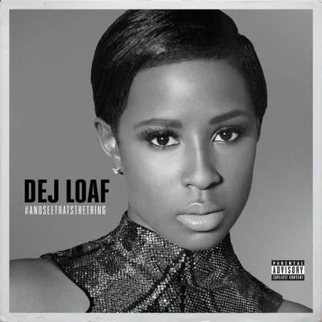

*I’ve expressed my love for music & ya’ll know I’m a bit kooky. I often relate things happening in my life to the music I am listening to. While it is not specific to the song’s lyrics or meaning; a phrase, a verse or the hook may spark a thought.*

# **Life set to And See That’s The Thing, Deja Trimble (DeJ Loaf)**

## "**Desire”**

There is a saying that boredom is the desire for desires.

I have many desires…

## **“Been On My Grind”**

Two ways to be rich: Make more or Desire less.

First we decide, then we justify…

## **“Back Up”**

Striving for perfection, we tend to worry when we are not producing anything, and we worry about whether what we produce will measure up. *Back up* and remember why you’re doing it…

## **“Hey There”**

Keep desires for immediate gratification under control.

Slow down, enjoy the moment without following the urge. Slowing down prolongs the pleasure...

## **“Butterflies”**

I have the desire to do what is good, but I cannot carry it out - Romans 7:18

Slowing stomach function, increasing heart rate; fight or flight…

## **“We Winnin’”**

Speaks for itself.

I Am
