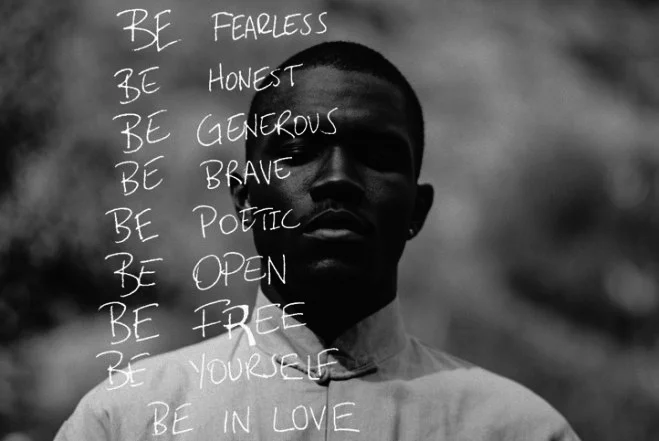

Music is my drug of choice. I’ve been getting high with Christopher
Breaux lately; personal reflection, love, transformation, social commentary and
nostalgia.

**Life set to Nostalgia Ultra, Frank Ocean**

###

**Streetfighter**

I’ve been in Charlotte for a little more than twelve years,
without a connection to the city I would know of the life and work of Julius L.
Chambers. On August 2, 2013 we lost a streetfighter for justice. Rest.

**Strawberry Swing**

Nothing blesses a man more than when a woman is involved in
his recreation. Love, food & exercise … I’ma lace my sneakers to this one.

**We All Try**

Those of you who follow me on the twitter know what a BIG
fan of The Good Men Project I Am. Time to change the conversation about manhood
and masculinity. No more talk about becoming a good man, become one.

**Bitches Talkin**

She/He processes words, ideas, needs and problems but all
against you. *Don’t let them front you to
saying you can’t move.* Those bitches just talking.

**Songs 4 Women**

We deceive and then we deceive about the fact that we
deceive. I’ve called bullshit on my past, I believed being honest about my
intentions with women was not the same as lying.

**LoveCrimes**

There is a lot of talk in these social streets but ain’t
nobody saying nothing. Dating, singlism, relationships; the greatest crime
against love is to not change the current conversation.

**There Will Be Tears**

We remember best the things that arouse us the most. A bunch
of words beginning with L for most of us; life, love, loss, lust, loneliness …

**Swim Good**

To love means to cherish, to care for and to show affection.
*“I'mma try to swim from something bigger than me.”*

Not the complete track list
but we tired.

I Am
