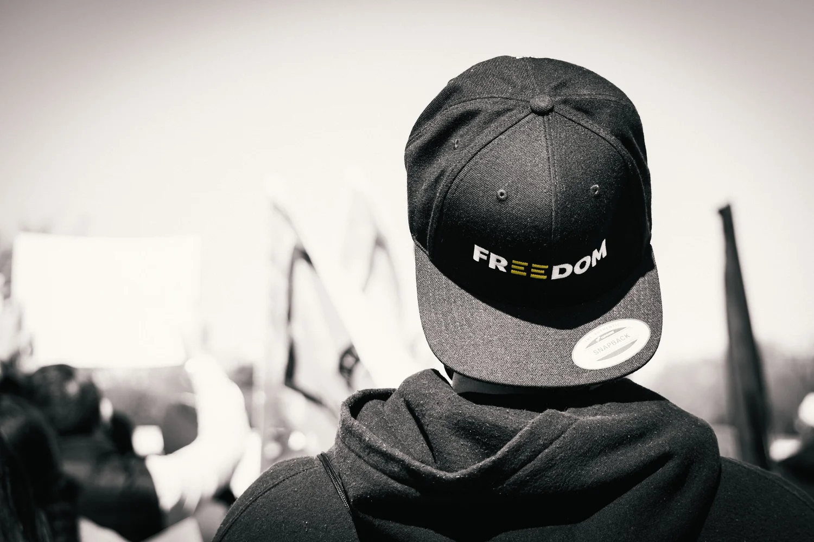

*I’ve expressed my love for music & ya’ll know I’m a bit kooky. I often relate things happening in my life to the music I am listening to. While it is not specific to the songs lyrics or meaning; a phrase, a verse or the hook may spark a thought.*

Music is my drug of choice & I’ve been getting high with Justin Drew Bieber; personal reflection, love, transformation, social commentary and nostalgia.

## **Life set to Freedom (EP), Justin Drew Bieber**

### **“Freedom”**

Sometimes it takes a great sky to find that first, bright and indescribable wedge of freedom in your own heart.

Freedom, don’t it feel good.

### **“All She Wrote”**

Love songs suck, so I wrote a cluster fuck; I’m not in the market for any fresh trauma unless karma supplies me two days notice.

She writes, and I read between the lines.

### **“We’re in This Together”**

We all receive the same amount of time each day: 24 hours, 1,440 minutes, or 86,400 seconds. But at the end of that day, the time is gone. Time cannot be stolen, exchanged, refunded, stockpiled, or hacked. Time is extremely limited and insanely in demand.

Find someone to do life with.

### **“Where You Go I Follow”**

Don't follow footsteps, create them.

### **“Where Do I Fit In”**

Ex nihilo nihil fit

Supposedly a quote by the Roman philosopher Lucretius, the Latin motto means "nothing comes from nothing," and is used as a reminder that hard work is always required in order to achieve something.

If it doesn’t fit, you must (ac)-quit.

### **“Afraid to Say”**

No.

Emotionally intelligent people won’t say yes unless they really want to.

I’m not afraid of bad things happening but good things not happening.

Shout out to my High School Latin teacher,

I remain.
