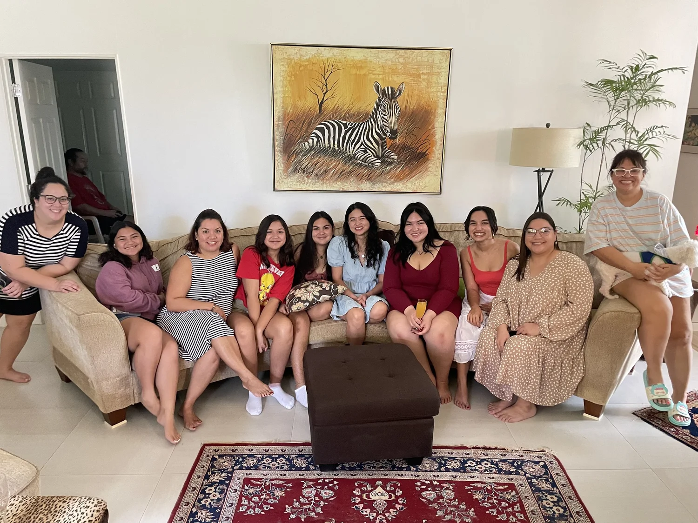

**LIFE CHANGES,**

**As Do Titles and Roles**

As a single, motherless woman in the prime of life, with 19 nieces & nephews, and 8 grand-nieces & nephews – there’s a role that I have grown into amongst my Calvo Clan – that of “Auntie Nicci, The Cool Aunt”.

Trust me when I tell you that I never took myself for the one person that all my siblings’ children gravitate toward. To be frank, I’m not particularly nurturing or motherly or sweet, but for whatever reason these younger generations ask frequently to sleepover or hangout or have a bbq or have poker nights at my house at least twice a month.

This has led me to reflect on life’s changes which affect the roles and titles (albeit subliminally) we acquire as we gain more wisdom & grace with aging.

I used to be considered the anti-social family gatherings relative. You know, the one that never or rarely shows up to holiday or birthday celebrations with the family. I was in my 20’s and 30’s, and I didn’t have spare time to waste or rather I was wasted on my spare time so I couldn’t get up to make it to the family functions. Somehow in my 40’s this started changing, for better or worse, my body caught up with my age and the family functions were easier to make now; besides drinking at home became way cheaper than at a bar. Thus, family gatherings started to fill my social calendar.

Now in my early 50’s, I see that the nieces and nephews have also matured, we’ve become confidantes and friends now. They sometimes seek my sage advice but most times, they just like to hear how I easily messed up my life but always in the most humorous of light, cause after all laughter is contagious and ohhh so good for the soul.

So, as life changes so do the roles we play, and I’m okay with that.

Nicole
